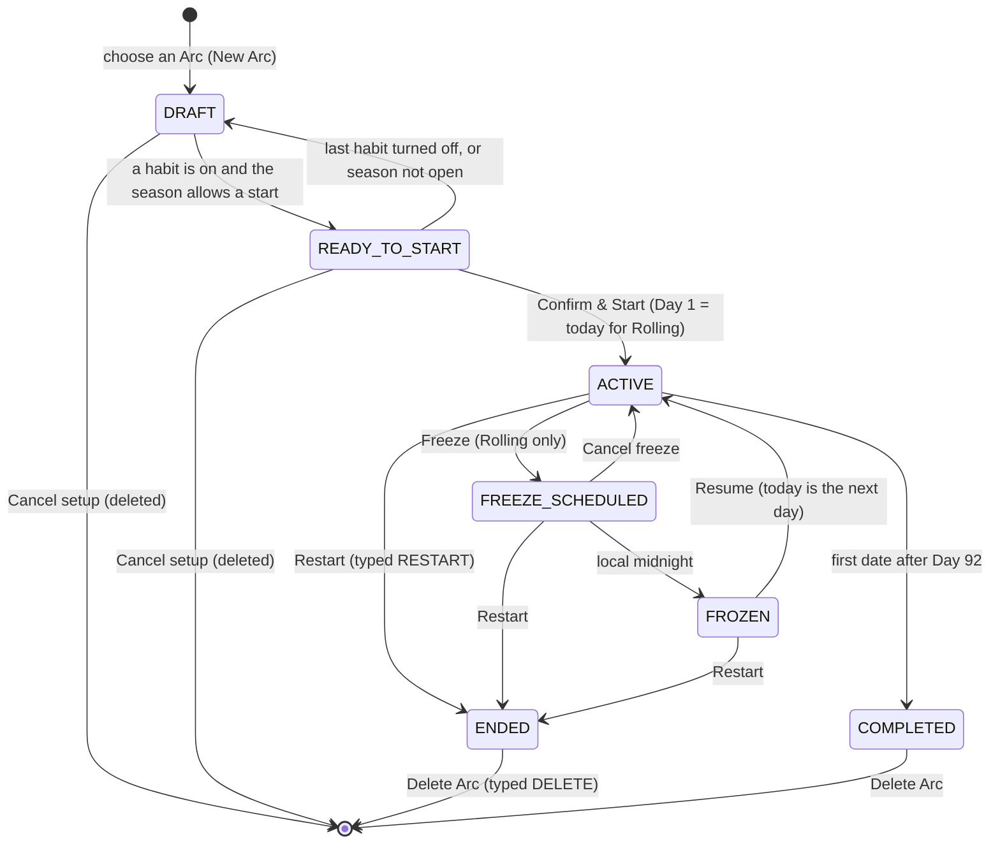

# Arc Control specification (NextRep v1.3.0)

Product rules for the five features added to v1.3.0 in the Phase 12A
Addendum: habit reordering, saved setup with a start confirmation, Freeze
and Resume, Restart with an optional deletion of the old Arc, and
completion sounds. Nothing here is implemented yet. Source evidence,
decisions, the schema and backup design and the test plan are in
[PHASE_12A_ADDENDUM.md](PHASE_12A_ADDENDUM.md); phases and gates are in
[V1_3_ROADMAP.md](V1_3_ROADMAP.md); the effect on the Weekly Review and
the Calendar is in
[ARC_MOMENTUM_SPEC.md § 12](ARC_MOMENTUM_SPEC.md#12-lifecycle-addendum-freeze-and-restart).

Labels: **CONFIRMED** (verified in the source at `main` `64d77e0`),
**PROPOSED** (a decision of this spec), **UNRESOLVED** (owner decision or
device qualification). Everything in this spec is PROPOSED unless it says
otherwise. `T` is today's local date (`Clock.today()`).

---

## 1. Objective

Arc Momentum (Weekly Review, Calendar) helps users understand an Arc.
Arc Control lets them shape one: arrange it, prepare it ahead of time,
pause it honestly, begin again without rebuilding it, and hear a small
reward when a habit is done. Everything stays on the device. No rule for
XP, streaks, Perfect Days, Minimum Days or achievements changes.

## 2. User stories

| # | As a user… | …I want to… | Feature |
|---|---|---|---|
| C1 | setting up an Arc | put my habits in the order I do them | Reorder |
| C2 | using a keyboard, switch or screen reader | move a habit up or down without dragging | Reorder |
| C3 | planning on Monday | build the whole Arc and start it on Friday | Saved setup |
| C4 | reopening the app | see that my setup is saved, and edit, review or start it | Saved setup |
| C5 | about to start | see exactly what Day 1 and the last day will be before I commit | Confirm |
| C6 | who will be away or unwell | pause a Rolling Arc so those dates don't count as missed | Freeze |
| C7 | who paused | come back and continue on the day I left off | Resume |
| C8 | who fell behind | start again from Day 1 with the same habits and goals | Restart |
| C9 | who restarted | keep my old Arc in history by default | Restart |
| C10 | who wants a clean slate | delete the old Arc, only when I clearly ask for it | Delete |
| C11 | completing a habit | hear a short, pleasant sound | Sounds |
| C12 | in a quiet place | turn sounds off, and never be surprised by one on a silenced phone | Sounds |

## 3. Lifecycle state machine

The conceptual states of the brief map onto stored state as follows. Only
`ENDED` adds a stored status value; `DRAFT`, `READY_TO_START`,
`FREEZE_SCHEDULED` and `FROZEN` are derived.

| Conceptual state | Stored as | Derived from |
|---|---|---|
| DRAFT | session `status = setup` (CONFIRMED, exists) | `!ArcSetup.canStart` |
| READY_TO_START | the same `setup` session | `ArcSetup.canStart`: the season allows a start today and at least one habit is on |
| ACTIVE | `status = active` (CONFIRMED) | `T` is a challenge date |
| FREEZE_SCHEDULED | `active` + an open `arc_freezes` row | `T < frozenFrom` |
| FROZEN | `active` + a freeze row | `T` is inside a freeze interval |
| COMPLETED | `status = completed` (CONFIRMED) | set by close-out after Day 92 |
| ENDED (restarted) | `status = ended`, `closed_on` set | set by Restart |



Invariants:

1. At most one session is `setup` or `active` (CONFIRMED:
   `single_open_session`). Restart ends the old Arc and starts the new one
   in one transaction, so this holds at every commit.
2. Saving never starts. The only transition into ACTIVE from a setup is
   the confirm button of [§ 4.3](#43-review-and-confirm--start).
3. FROZEN never becomes COMPLETED. A frozen Arc ends only by Resume (and
   then living its days) or by Restart.
4. COMPLETED and ENDED are read-only history. Nothing writes to them
   except their own deletion.
5. A Seasonal Arc never enters FREEZE_SCHEDULED or FROZEN.

## 4. Setup

### 4.1 Habit reordering

- **Where:** the habit list of Habit Setup (`/setup`), for the Arc in
  setup only. A running Arc's order is fixed (decision AD2).
- **Drag handle:** each habit card gets a handle at its leading edge
  (48 × 48 dp target). Pressing the handle starts the drag at once.
- **Touch and hold:** a long press anywhere else on the card also starts
  the drag. A short tap keeps its meaning (switch the habit on or off).
- **Keyboard and switch access:** the card's existing options menu
  (Edit, Remove) gains **Move up** and **Move down**. They are disabled
  on the first and last card respectively.
- **Screen readers:** each card exposes "Move up" and "Move down" as
  custom accessibility actions, and its label ends with its position:
  "Water, 8 glasses, on, 2 of 8". After a move the new position is
  announced: "Water moved to position 1 of 8".
- **Visual feedback:** the dragged card lifts (elevation and a 1.02
  scale), the others slide to open a gap; on drop it settles. With
  reduced motion the lift and slide are instant (`context.motion`).
  A light haptic marks pick-up and drop.
- **Persistence:** on drop, the whole list's order is written in one
  transaction (`sort_order = 0..n−1`), then the setup is re-read, as every
  other setup change is. If the write fails, the list returns to the
  stored order and a snackbar says "Couldn't save the new order."
- **Order afterwards:** the stored order is what Habit Setup shows after
  saving and reopening, what Review and Confirm list, the order on Today,
  Habits, Journey day sheets, the Weekly Review and share cards once the
  Arc starts, the order a Restart or "Reuse last setup" copies, and the
  order a backup restores.
- **Disabled habits** stay in the list where they are and can be moved.
  Their position is kept if they are switched on later.
- **Custom habits** move exactly like built-in ones. A new habit (template
  or custom) is added at the end.
- **Maximum 12 habits:** reordering never changes the count; the limit
  and its message are unchanged.
- **Editing:** editing a habit keeps its position (CONFIRMED:
  `SetupHabitRules.edit`). The form sheet cannot be opened during a drag.
- **Never changed by a move:** habit id, title, type, unit, targets,
  enabled state, and (there being none in setup) any progress, XP or
  history.

### 4.2 Saved setup

- **Save semantics.** Every setup change is committed when it is made
  (CONFIRMED). "Save for Later" therefore writes nothing new. It confirms
  ("Your Arc setup is saved.") and opens the saved-setup hub.
- **Crash and process death.** The setup is as of the last committed
  change. The only thing that can be lost is text typed into an open
  habit form that was never submitted.
- **Reopening.** On launch, a setup session opens the **saved-setup hub**
  (`/setup/saved`), not the editor. The hub offers Continue Editing,
  Review Setup and Start Challenge.
- **Editing after saving.** Continue Editing opens Habit Setup with
  everything editable, as before.
- **One draft.** There is at most one saved setup. Starting another Arc
  type means cancelling this one first (existing "Cancel setup").
- **Deleting a draft.** "Cancel setup" on the hub and in the editor, with
  the existing dialog. Completed and ended Arcs are untouched.
- **Zero habits.** Allowed in a draft. It cannot start; the hub and the
  review say "Add a habit to start."
- **Validation.** A draft is ready when at least one habit is on and the
  Arc can start today. Habit rules (names, targets, 12 at most) are
  enforced when each habit is saved, as today.
- **Dates.** A Rolling draft has no meaningful dates. No screen shows its
  provisional start date. Day 1 is the local date on which Confirm & Start
  is pressed. The days between saving and starting are not days of the
  Arc, so they can never be missed days.
- **Seasonal drafts.** Unchanged rules (CONFIRMED): creatable from
  1 September, startable only 1 October – 31 December, joining on the
  season's own day number. Before 1 October the hub shows "Season starts
  October 1. Your setup is saved until then." and Start is disabled. After
  31 December the draft can only be cancelled. The confirm screen calls
  the same domain rule, so it cannot bypass either.
- **Backup.** A draft is exported and restored like any Arc (CONFIRMED).
  After a restore the hub opens on it.
- **New install.** Onboarding → choose an Arc → Habit Setup, as today.
  Save for Later is available from the first screen of setup.
- **Returning user.** With completed or ended Arcs and a draft, launch
  opens the hub. The hub links to Arc History.
- **Settings before starting.** The hub links to Reminders, Sound &
  Feedback, Data & Backup, Focus Guard (Android) and About. Reminder times
  can be chosen before the start; nothing is scheduled until an Arc is
  active (CONFIRMED: `ReminderPlanner.plan` returns nothing without an
  active Arc). Hydration Coach shows as unavailable until then.
- **Not included:** a reminder to start a saved setup; preparing a next
  Arc while one is running; more than one draft.

### 4.3 Review and Confirm & Start

- **Review Setup** is read-only: the Arc type, what the dates will be, the
  habits in order with their targets and Minimum Day targets, habits that
  are off (listed separately as "Off"), and whether reminders are on.
- **Confirm & Start** is a separate screen reached only from Review
  Setup. The hub's Start Challenge and the editor's Review & Start both
  open Review first. It states the consequence and offers two clearly
  different actions:
  - **Confirm & Start Challenge** (primary, filled).
  - **Save for Later** (secondary, outlined, never adjacent without
    spacing; never the default action of a keyboard Enter).
- **What starting does** (CONFIRMED, unchanged): Rolling: Day 1 is today,
  the last day is today + 91. Seasonal: Day 1 stays 1 October; the user
  joins today on the season's day. One atomic write; pressing twice starts
  once.
- **The date shown is the date used.** The screen shows "Day 1: <today>"
  from the same clock read the domain will use, and refreshes on resume
  and at midnight. If the date changed between showing and pressing, the
  Arc starts on the new date and the Today screen says so by its date.

## 5. Freeze and resume (Rolling Arcs only)

### 5.1 Model

A Rolling Arc is 92 **challenge days**. A freeze removes calendar dates
from the Arc without removing challenge days.

```
freezes(s)         ordered intervals (frozenFrom, resumedOn | open)
frozen(D)          frozenFrom ≤ D and (open or D < resumedOn), for some interval
challengeDate(D)   s.participationStart ≤ D ≤ s.endDate and not frozen(D)
dayNumberOf(D)     startDate.daysUntil(D) + 1 − |{ frozen dates before D }|
dateOfDay(n)       the challenge date with dayNumberOf = n
                   (unknown for days after an open freeze begins)
endDate            startDate + 91 + |{ dates in closed intervals }|
```

- A frozen date is **not a day of the Arc**. It has no day number, no
  record, no XP, no Minimum Day, no reflection, and it appears in no
  count. It is never "missed".
- Dates already lived keep their day numbers for ever (addendum AD5).

Two kinds of stored date (CONFIRMED, addendum § C7):

```
activity row       progress, day mode, XP, reflection, achievement unlock:
                   dated on the local day it was written (an unlock: on or
                   before it)
configuration row  goal revision: dated the day AFTER it was written
lastActivityDate   the latest date of any activity row of the Arc, or none
clock guard        T ≥ participation start, T ≥ lastActivityDate,
                   and T ≥ the latest resumedOn
```

- A goal revision is **never** activity. It does not show that a day was
  lived, it does not move a freeze, and it is not counted by Restart.
- A revision is never re-dated. `configOn(habit, D)` uses the latest
  revision dated on or before `D`, so a revision whose date falls in a
  pause applies from the first challenge day after it.

### 5.2 Rules

| # | Rule |
|---|---|
| F1 | Freeze is offered only for an `active` **Rolling** Arc. Never for a Seasonal Arc, on any screen. The service refuses it for one, whatever the UI shows. |
| F2 | A freeze starts at the **next local day boundary**: `frozenFrom = T + 1`, always. Today finishes as a normal challenge day and can be completed, including as a Minimum Day. A goal edit made today (a revision dated `T + 1`) does not change this. |
| F2a | Freeze is accepted only when the **clock guard** holds. If the phone's date is earlier than the latest logged day (or than the last resume), Freeze is refused, nothing is stored, and the message names the date from which it is available. The start date is never silently moved. |
| F3 | Until `frozenFrom`, the freeze is **scheduled**. Cancelling it deletes it; nothing was paused. |
| F4 | Freeze is not offered on Day 92 (no day left to pause), nor while a freeze is scheduled or the Arc is frozen. |
| F5 | **Resume** on date `R` sets `resumedOn = R` and extends `endDate` by `R − frozenFrom`, in one transaction. `R` is the next challenge day. |
| F6 | While frozen, the Arc is read-only: no habit progress, Minimum Day, habit edit or reflection for a frozen date. History stays viewable. |
| F7 | No XP is awarded for freezing or resuming. No activity row and no goal revision is changed, re-dated or removed by freeze, cancel or resume. |
| F7a | A goal revision waiting for tomorrow stays as stored and applies on the resume date. While paused, habits are read-only (F6), so no new revision is written. |
| F8 | Streaks continue across a pause: frozen dates neither grow nor break them. |
| F9 | Daily, reflection and Hydration Coach reminders are not planned for frozen dates. They are re-planned right after freeze, cancel and resume. No new kind of notification is added. |
| F10 | **Focus Guard is independent** and keeps its own schedule and budget during a freeze (addendum AD9). The Freeze sheet says so. |
| F11 | There is no maximum pause and no automatic resume in v1.3 (addendum AD8). The total paused days are shown in the Arc's summary and its Arc History card. |
| F12 | A frozen Arc never completes. Close-out happens only after its 92nd challenge day. |
| F13 | Two freezes are always separated by at least one lived challenge day (follows from F2 and F5). |

### 5.3 Worked example

A Rolling Arc starts on 1 March 2027 (Day 1), so it would end on
31 May 2027.

| Date | Event | State |
|---|---|---|
| 10 March | Day 10. The user taps Freeze. `frozenFrom = 11 March` | FREEZE_SCHEDULED; Day 10 is still open and counts |
| 11 March 00:00 | (no write) | FROZEN |
| 11–19 March | 9 frozen dates | not days of the Arc |
| 20 March | The user taps Resume. `resumedOn = 20 March`; `endDate = 31 May + 9 = 9 June` | ACTIVE; today is **Day 11** |
| 9 June | Day 92 | last day |
| 10 June | close-out | COMPLETED |

Check: `dayNumberOf(20 March) = 19 + 1 − 9 = 11`.

**With a goal edit on the same day.** On 10 March (Day 10) the user first
raises Reading from 10 to 20 pages. That stores a revision dated
11 March. Then they tap Freeze.

| Date | What applies |
|---|---|
| 10 March (Day 10) | Reading 10 pages. `frozenFrom = 11 March`: tomorrow, as the sheet said. The revision is not activity and does not move it |
| 11–19 March | Paused. The revision of 11 March is stored, unchanged, on a paused date |
| 20 March (Day 11) | `configOn(Reading, 20 March)` = the revision of 11 March → **20 pages** |
| Days 1–10 | Still 10 pages: their dates are before 11 March |

**Day 91.** 30 May is Day 91. Freeze → `frozenFrom = 31 May`, the
planned last date. The user resumes on 5 June: 31 May – 4 June were
paused (5 dates), 5 June is **Day 92**, `endDate = 31 May + 5 = 5 June`,
and the Arc completes on 6 June. On Day 92 itself Freeze is not offered.

**Clock behind the history.** Habits were logged on 10 March. The phone's
date then moves back to 9 March and the user taps Freeze. It is refused:
"Your phone's date (9 Mar) is earlier than your latest logged day
(10 Mar). You can pause from 10 Mar. Nothing was changed." On 10 March
Freeze works and starts on 11 March. Starting it on 10 March instead
would have put that day's progress and XP on a paused date.

### 5.4 Clock and device cases

| Case | Result |
|---|---|
| Midnight with the app open | The day-change refresh shows the frozen screen. Nothing is written. |
| App closed or phone rebooted while frozen | Nothing depends on a running process. On next launch the state follows from the stored dates. |
| Date moves back before `frozenFrom` | That date is a challenge date: Today is open again until the date returns. |
| Date moves back into a closed interval | Paused and read-only, with "Continues on <resume date>". |
| Date moves back before a resume, to a date with rows | Rows stay. The date is shown by the same date rules as any other; nothing is rewritten. |
| Date is earlier than the latest logged day, or than the last resume | Freeze is refused until the date catches up (F2a). Tracking today still works. |
| Paused Arc exported and restored | The freeze and any waiting revision are restored as stored. The Arc is paused on the new device; the revision applies on resume. |
| Daylight saving | No effect. |

## 6. Restart

### 6.1 Meaning

Restart starts a **new** Rolling Arc on Day 1 today with the same setup,
and ends the current Arc as history. The current Arc is never reset,
overwritten or re-dated.

### 6.2 What happens, in one transaction

1. **Preconditions**, all re-checked inside the transaction:
   - the Arc being restarted is still the unfinished Arc and is `active`;
   - it is not over on `T` (an Arc past its last day completes instead);
   - the **clock guard** of § 5.1 holds.

   If any fails, nothing is written and the reason is shown (§ 6.7).
2. Old Arc: `status = ended`, `closed_on` = its **last lived day**
   (below). A freeze that was scheduled or not yet resumed is removed.
   Nothing else in the old Arc is touched: no activity row and no goal
   revision is changed, re-dated or deleted.
3. New Arc: a Rolling session, `active`, Day 1 = `T`, last day =
   `T + 91`, with the habits of § 6.3.

If any step fails, nothing changes. Afterwards, best effort and repeatable
on the next launch: reminders are re-planned for the new Arc, pending
celebrations are cleared, the app goes to Today.

**The last lived day.** `closed_on` is the first of these that applies:

| Case | `closed_on` |
|---|---|
| `T` is a challenge date and an activity row is dated `T` | `T` |
| a challenge date exists before `T` | the last one |
| neither (Day 1, nothing logged yet) | the participation start (= `T`) |

What does and doesn't count as lived:

| Date | Lived? |
|---|---|
| A past challenge date, with or without progress | Yes |
| Today, with any activity row | Yes |
| Today, with nothing logged | No (except Day 1, so an ended Arc has at least one day) |
| A date that only has a goal revision waiting on it | No |
| A paused date | No |
| A future date | No |
| A date later than today that already has activity (clock moved back) | Restart is refused instead (§ 6.7) |

So `closed_on` is always a challenge date and never after `T`.

### 6.3 What is copied

| Copied to the new Arc (as its Day 1 baseline) | Not copied (stays with the old Arc) |
|---|---|
| Habit ids, built-in and custom | Dated goal revisions |
| Names | Daily progress |
| Types and units | Minimum Day history |
| Icons | XP and level |
| Targets and Minimum Day targets, as they stand now (including a change made today for tomorrow) | Streaks and Perfect Days (derived from the above) |
| On / off state | Achievement unlocks |
| Display order | Journal reflections |
| | Freezes |

App-level settings are not part of an Arc and are unchanged: reminders
(they continue for the new Arc), Hydration Coach, Focus Guard, sounds.

### 6.4 By situation

| Situation | Behaviour |
|---|---|
| Active Rolling Arc | Restart as above. |
| Frozen Rolling Arc, or freeze scheduled | Restart as above; the old Arc ends on its last lived day. |
| Completed Rolling or Seasonal Arc | Nothing is ended. The existing "Start New Arc → Reuse last setup" flow applies (CONFIRMED), followed by Review and Confirm & Start. No typed word is needed. |
| Active Seasonal Arc (also a late join) | Offered as **"Start a Rolling 92-Day Arc with this setup"**. The season participation ends; the new Arc is Rolling, Day 1 today. The season's Day 1 is never moved. |
| Edited goals | The latest goals become the new baseline, including a change made today that was waiting for tomorrow. The waiting revision itself stays in the old Arc, unapplied. |
| Day 92 | Allowed, with an extra line: "Today is this Arc's last day. If you wait until tomorrow it will be completed." Restarting today ends it as "Ended early · Day 92", without Summit. |
| Phone's date earlier than the latest logged day | Refused (§ 6.7). |
| Custom habits | Copied with their ids. |
| Minimum Day history, XP, achievements | Stay with the old Arc. The new Arc starts at 0 XP, level 1, no unlocks; achievements are earned again by the new Arc's own history, by the existing rules. |
| Reminders enabled | Stay enabled and are planned from the new Day 1. |

### 6.5 The old Arc afterwards

- Status **Ended early**, shown as "Ended early · Day N of 92", where N
  is the day number of `closed_on`. Never "Completed".
- It keeps its Journey, Journal, achievements, Weekly Reviews and summary,
  read-only, under Arc History.
- It does not earn Summit. Achievements it had already earned stay.
- Insights include its lived days and do not count it as a completed Arc.
- Its progress, Minimum Days, XP, achievements, reflections and goal
  revisions are exactly as they were. A revision that was waiting when
  the Arc ended stays stored after `closed_on` as a record of a planned
  change. The Arc is only ever read for dates up to `closed_on`, so that
  revision never changes a lived day.
- A backup holds it as `ended` with `closedOn`. `closedOn` is never after
  the restart date, so it is never after an export made later.

### 6.6 Typed confirmation

- The Restart sheet explains the consequence, then asks the user to type
  **RESTART**.
- The confirm button is enabled only when the field, trimmed, equals
  `RESTART` exactly. The keyboard opens in capitals.
- Nothing is changed until the confirm button is pressed. Cancel, Back
  and dismissing the sheet change nothing.
- History choice on the sheet: **Keep my old Arc in Arc History**
  (selected) or **Delete my old Arc…**. Choosing the second does not
  delete anything; it adds the separate step of § 7 after the restart.

### 6.7 Safe failure and clock rollback

| Situation | Result |
|---|---|
| Phone's date is earlier than the latest logged day, the last resume, or the Arc's first day | Refused before anything is written: "Your phone's date (17 Oct) is earlier than your latest logged day (18 Oct). You can restart from 18 Oct. Nothing was changed." |
| The Arc completed at midnight while the sheet was open | Refused; the sheet closes to the completed Arc's summary |
| Storage error at any step | The transaction rolls back. Both the old Arc and the absence of a new one are as before |

Restart never invents an end date in the future, never shortens the old
Arc below a day that has activity, and never deletes activity to make the
dates fit.

**Examples** (Rolling Arc started 7 October 2026):

| Today | Before Restart | `closed_on` | Old Arc reads |
|---|---|---|---|
| 16 Oct (Day 10) | 2 habits logged today; Reading goal edited (revision dated 17 Oct) | 16 Oct | Ended early · Day 10. The 17 Oct revision stays, unapplied. The new Arc starts with the edited goal |
| 16 Oct (Day 10) | Nothing logged today; Reading goal edited | 15 Oct | Ended early · Day 9. Day 10 and Day 11 are not counted |
| 17 Oct | Progress and XP are stored on 18 Oct; the date moved back | — | Refused. On 18 Oct Restart works and `closed_on` = 18 Oct |
| 25 Oct | Paused since 20 Oct | 19 Oct | Ended early · Day 13. The unresumed pause is removed |
| 7 Oct (Day 1) | Nothing logged | 7 Oct | Ended early · Day 1 |

## 7. Deleting the old Arc (optional)

| # | Safeguard |
|---|---|
| D1 | Keep is the default. Delete is never preselected. |
| D2 | Typing RESTART never deletes anything. Deletion needs its own screen and its own typed word, **DELETE**. |
| D3 | Deletion runs only after the restart has committed, as a second, separate transaction. |
| D4 | If the user leaves the delete screen, or the app stops before it, the old Arc is kept. No "delete later" intent is stored. |
| D5 | A deletion failure leaves both Arcs exactly as they were. The new Arc cannot be affected: deletion is by the old Arc's id. |
| D6 | The screen lists what will be lost, in numbers, and recommends a backup first, with a button to Data & Backup. |

**Scope: the whole old Arc** (CONFIRMED for completed Arcs in
`DriftWinterArcRepository.deleteSession`; extended to `ended` Arcs and to
freeze rows):

| Removed | Not removed |
|---|---|
| The Arc's History card and summary | Every other Arc, including the new one |
| Its habits and goal revisions | Reminder, Hydration Coach, Focus Guard and sound settings |
| Daily progress and Minimum Day records | Backup files already exported |
| Its XP entries and level | |
| Its achievements | |
| Its Journal reflections | |
| Its freeze records | |

Consequences stated on the screen:

- **Insights** are calculated from the Arcs that exist, so the deleted
  Arc's days, XP and moods leave every Insights figure.
- **Achievements** belong to one Arc. There are none shared between Arcs,
  so no other Arc loses one.
- **Reflections** written during the old Arc are deleted with it.
- An **earlier backup** still contains the Arc. Restoring it replaces all
  current data with that backup.

The same screen is used when an ended or completed Arc is deleted later
from Arc History (owner decision O11).

## 8. Completion sounds

### 8.1 When a sound plays

A sound plays only after a habit action has been saved, and only when
that save made the habit go from not complete to complete (CONFIRMED hook:
the commit's ledger grants this habit's award, `TodayScreen._perform`).

| Event | Sound |
|---|---|
| Binary habit marked done | Habit sound |
| Count habit: a step below the target | None |
| Count habit: the step that reaches the target | Habit sound |
| Duration habit reaching its target | Habit sound |
| Clock time logged at or before the goal | Habit sound |
| Clock time logged after the goal | None |
| Completion reversed (undo, decrement, time cleared) | None |
| Completion restored after a reversal | Habit sound, subject to the throttle |
| The completion that makes today a Perfect Day | **Perfect Day sound instead of** the habit sound, once per date |
| Switching to a Minimum Day (may complete several habits) | None |
| The last habit of a Minimum Day reaching its minimum | Habit sound (no special sound) |
| Returning to full targets | None |
| Level-up, achievement | None (their cards keep their haptics) |
| Opening a screen, launch, midnight, restore, achievement backfill | None |

### 8.2 Throttle

- At most one sound per 500 ms across the app, and one per habit per 3 s.
- A sound that is throttled is dropped. Sounds are never queued, so they
  can never play late or pile up.
- The Perfect Day sound plays at most once per Arc and date per app
  process.

### 8.3 Sound sets

Three original sets. The names are illustrative (UNRESOLVED, owner).

| Set | Character | Habit sound | Perfect Day sound |
|---|---|---|---|
| **Ice Crystal** (default) | bright, glassy, two soft partials | ≈ 350 ms | ≈ 900 ms rising three-note figure |
| **Summit Spark** | a quick rising fifth, plucked | ≈ 450 ms | ≈ 900 ms |
| **Warm Ember** | low, soft, mallet-like | ≈ 400 ms | ≈ 900 ms |

Requirements for the assets (to be produced in 12G, not in this phase):

- Original: synthesised for NextRep, with the generating script or
  session committed so the source is reproducible. No samples from games,
  films, music or sound libraries. Released under the repository's MIT
  license.
- Mono, under 1 second, peak-normalised a few dB below full scale, with a
  short fade at both ends so nothing clicks.
- Six files, well under 200 KB in total. Bundled in the app; never
  downloaded.

### 8.4 Settings

**Sound & Feedback** (`/settings/sound`), reachable in every state like
the other settings:

- **Completion sounds** on / off. Default on.
- **Sound**: Ice Crystal / Summit Spark / Warm Ember. Selecting one plays
  it once as a preview (subject to the same device rules).
- A line of help: "Sounds follow your phone's sound settings. They stay
  quiet on silent and Do Not Disturb."
- Haptics are unchanged and have no switch in v1.3.

### 8.5 Device behaviour

| Condition | Expected | Status |
|---|---|---|
| Android ringer on | Plays at the system's sonification volume; no in-app volume | PROPOSED |
| Android silent or vibrate | Silent | PROPOSED; UNRESOLVED until measured |
| Android Do Not Disturb | Silent | UNRESOLVED until measured |
| Music or a podcast playing | The sound mixes in; playback is not paused or lowered by NextRep | PROPOSED |
| Headphones connected | Plays where system sounds play | UNRESOLVED until measured |
| TalkBack on | Plays; must not cut the spoken confirmation | UNRESOLVED until measured |
| iOS silent switch on | Silent (ambient session) | PROPOSED; simulator smoke only, no iOS release |
| Sound not loaded yet | Skipped silently; never delays the habit action | PROPOSED |

Playback is local. No permission, no network, no new notification
channel. The sound is feedback only: it never decides anything, and a
failure to play is ignored.

### 8.6 Backup and restore

The setting is part of backup format 4 and is restored as stored. A
format 1–3 backup has none, so the device keeps its current setting. A
restore never plays a sound.

## 9. Text wireframes

Phone, 1× text. All screens use the existing design system: `WinterCard`,
`PrimaryButton`, `WinterBackground`, `FailureView`, `LoadingView`, the
`WinterSpacing` / `WinterColors` tokens, and the danger colour already
used by "Cancel Setup" and "Delete Arc". Every flow keeps content within
600 dp and scrolls vertically; nothing scrolls sideways. Above 1.3× text,
side-by-side rows stack (the rule `focus_guard_settings_screen.dart`
already uses).

### 9.1 Setup habit reordering

```
┌──────────────────────────────────────────┐
│ YOUR WINTER ARC                          │
│ Rolling 92-Day                           │
│ 92 days from the day you press Start.    │
│                                          │
│ Choose your habits                       │
│ Hold and drag to put them in your order. │
│                                          │
│ YOUR HABITS                              │
│ ┌──────────────────────────────────────┐ │
│ │ ≡  💧 Water                   ⋮  (●) │ │
│ │       8 glasses · Minimum 4          │ │
│ └──────────────────────────────────────┘ │
│ ┌──────────────────────────────────────┐ │
│ │ ≡  🏋 Workout                 ⋮  (●) │ │
│ │       30 min · Minimum 10            │ │
│ └──────────────────────────────────────┘ │
│ ┌──────────────────────────────────────┐ │
│ │ ≡  📖 Reading                 ⋮  ( ) │ │
│ └──────────────────────────────────────┘ │
│ [ + Add Habit ]                          │
│                                          │
│ 2 habits selected                        │
│ [        Review & Start        ]         │
│ [        Save for Later        ]         │
│          Cancel setup                    │
└──────────────────────────────────────────┘
 ⋮ menu: Move up · Move down · Edit · Remove
```

| | |
|---|---|
| Entry point | Habit Setup (`/setup`): after choosing an Arc, or Continue Editing from the hub |
| Primary action | Drag a habit by its handle (or long-press the card) and drop it |
| Secondary action | Move up / Move down in the card menu |
| Cancel | Dropping the card where it was changes nothing. There is no undo beyond moving it back |
| Back | System back leaves setup as today (the setup stays saved) |
| Disabled states | Move up on the first card; Move down on the last; no drag with a single habit |
| Errors | Save failed: list returns to the stored order; snackbar "Couldn't save the new order." |
| Persistence | One transaction per drop; re-read afterwards |
| Accessibility | Handle: "Reorder Water". Card label ends "2 of 8". Custom actions Move up / Move down. Position announced after a move |
| Large text | The handle stays 48 dp; the card grows; the switch moves under the title above 1.3× |
| Empty state | "No habits yet. Add one to begin." (existing); no handles |

### 9.2 Save for Later

```
┌──────────────────────────────────────────┐
│ ✓ Your Arc setup is saved.               │
│   It stays here until you start it.      │
└──────────────────────────────────────────┘   (snackbar, then the hub)
```

| | |
|---|---|
| Entry point | "Save for Later" in Habit Setup, Review Setup and Confirm & Start |
| Primary action | Save for Later → the saved-setup hub |
| Secondary action | None |
| Cancel | Not applicable: it changes nothing stored |
| Back | From the hub, system back leaves the app (the hub is the home of a setup) |
| Disabled states | Never disabled, including with zero habits |
| Errors | None of its own: every change was already saved when made. If the setup can't be re-read, the hub shows `FailureView` with Retry |
| Persistence | No new write |
| Accessibility | The confirmation is announced as a live region |
| Large text | Snackbar text wraps |
| Empty state | Saved with no habits: the hub says "Add a habit to start." |

### 9.3 Reopen saved draft (the hub)

```
┌──────────────────────────────────────────┐
│ YOUR WINTER ARC                          │
│ Your Arc Setup Is Saved                  │
│ Rolling 92-Day · 8 habits · 7 on         │
│ Day 1 will be the day you start.         │
│                                          │
│ [        Start Challenge        ]        │
│ [        Review Setup           ]        │
│ [        Continue Editing       ]        │
│                                          │
│ Reminders ›   Sound & Feedback ›         │
│ Data & Backup ›   Focus Guard ›          │
│ Arc History ›   About ›                  │
│                                          │
│          Cancel setup                    │
└──────────────────────────────────────────┘
```

Seasonal variants of the fourth line: "Season starts October 1. Your
setup is saved until then." (Start disabled) · "The season is on Day 42
of 92. Join now and start on Day 42." · "This season has ended. Cancel
this setup to choose a new Arc." (Start, Review disabled).

| | |
|---|---|
| Entry point | App launch with a setup session; Save for Later |
| Primary action | Start Challenge → Review Setup → Confirm & Start |
| Secondary action | Review Setup; Continue Editing |
| Cancel | Cancel setup → the existing confirmation dialog → deletes the draft |
| Back | System back leaves the app |
| Disabled states | Start Challenge when no habit is on, before 1 October (seasonal) or after the season; each with its reason as text under the button |
| Errors | `FailureView` with Retry if the setup can't be loaded |
| Persistence | Reads only |
| Accessibility | Heading "Your Arc Setup Is Saved"; the reason for a disabled Start is part of the button's label |
| Large text | Buttons full width, stacked; settings links one per line above 1.3× |
| Empty state | Zero habits: "Add a habit to start." and Continue Editing becomes the filled button. Arc History link only when a finished Arc exists; Focus Guard link on Android only |

### 9.4 Review Setup

```
┌──────────────────────────────────────────┐
│ ←  Review Setup                          │
│ Rolling 92-Day Arc                       │
│ Starts the day you confirm · 92 days     │
│                                          │
│ YOUR HABITS (7)                          │
│ 1  💧 Water        8 glasses · Min 4     │
│ 2  🏋 Workout      30 min · Min 10       │
│ 3  🌙 Sleep Before 23:00                 │
│ …                                        │
│ OFF (1)                                  │
│    📖 Reading                            │
│                                          │
│ Reminders: Daily 08:00 · Reflection off  │
│                                          │
│ [   Continue to Start   ]                │
│ [   Edit Setup          ]                │
│ [   Save for Later      ]                │
└──────────────────────────────────────────┘
```

| | |
|---|---|
| Entry point | Hub → Review Setup or Start Challenge; Habit Setup → Review & Start |
| Primary action | Continue to Start → Confirm & Start |
| Secondary action | Edit Setup; Save for Later |
| Cancel | Nothing to cancel: read-only |
| Back | To where it was opened from |
| Disabled states | Continue to Start, for the same reasons as the hub's Start |
| Errors | `FailureView` with Retry |
| Persistence | Reads only |
| Accessibility | Each habit is one node: "1. Water. 8 glasses. Minimum 4." |
| Large text | Target moves under the habit name above 1.3× |
| Empty state | "No habits yet." with Edit Setup as the filled button |

### 9.5 Confirm & Start

```
┌──────────────────────────────────────────┐
│ ←  Start your Winter Arc?                │
│                                          │
│ Rolling 92-Day Arc · 7 habits            │
│                                          │
│ Day 1    Today, Fri 13 Nov 2026          │
│ Day 92   Fri 12 Feb 2027                 │
│                                          │
│ Starting begins the count today. Days    │
│ you don't log will count as missed.      │
│ Not ready? Save it and start another day.│
│                                          │
│ [   Confirm & Start Challenge   ]        │
│                                          │
│ [        Save for Later         ]        │
└──────────────────────────────────────────┘
```

Seasonal: "You join today on Day 44 of 92. Earlier days won't count
against you. The season ends 31 Dec 2026." The primary button reads
"Confirm & Join Season".

| | |
|---|---|
| Entry point | Review Setup → Continue to Start |
| Primary action | Confirm & Start Challenge: starts the Arc, opens Today |
| Secondary action | Save for Later → hub, nothing started |
| Cancel | Back or Save for Later. Nothing is started by leaving |
| Back | To Review Setup |
| Disabled states | Primary disabled, with the reason, if the Arc can no longer start (season ended at midnight, last habit turned off elsewhere); busy and non-repeatable while starting |
| Errors | Start refused by the domain (season, no habits): the reason as a snackbar, and the screen re-reads. Storage error: "Couldn't start. Nothing was changed." with Retry |
| Persistence | One atomic write on confirm. Idempotent |
| Accessibility | The two buttons are separate nodes with full labels; focus starts on the heading, not on the primary button; the dates are read as full dates |
| Large text | Date rows stack label over value; 24 dp between the two buttons |
| Empty state | Not reachable with zero habits |

### 9.6 Freeze Rolling Arc

```
┌──────────────────────────────────────────┐
│ Pause your Arc                           │
│                                          │
│ From tomorrow, Sat 14 Nov, your Arc      │
│ stops counting days until you resume.    │
│                                          │
│ • Today (Day 25) still counts. You can   │
│   finish it, or use a Minimum Day.       │
│ • Paused days are never missed days.     │
│ • You continue on Day 26 when you resume;│
│   your last day moves later.             │
│ • Reminders pause. Focus Guard keeps its │
│   own schedule.  Focus Guard settings ›  │
│                                          │
│ [        Pause from tomorrow     ]       │
│ [        Not now                 ]       │
└──────────────────────────────────────────┘
```

Once scheduled, Today shows a banner: "Pause starts tomorrow. Today still
counts. · Cancel pause".

| | |
|---|---|
| Entry point | Today's overflow menu and the Habits screen: "Pause Arc". Shown for an active Rolling Arc only; absent for Seasonal Arcs |
| Primary action | Pause from tomorrow |
| Secondary action | Not now |
| Cancel | Not now, Back, dismissing the sheet: nothing changes. After scheduling: "Cancel pause" until midnight |
| Back | Closes the sheet |
| Disabled states | Entry hidden on Day 92, while a pause is scheduled and while frozen |
| Errors | "Couldn't pause. Nothing was changed." with Retry. A day that rolled over while the sheet was open: the sheet re-reads and shows the new dates. Phone's date earlier than the latest logged day: the refusal of § 5.2 F2a, naming the date |
| Persistence | One row written; reminders re-planned afterwards |
| Accessibility | Bullets are a list; the dates are read as full dates; the banner's Cancel is a labelled button |
| Large text | The sheet scrolls; buttons stack |
| Empty state | Not applicable |

### 9.7 Frozen Arc state

```
┌──────────────────────────────────────────┐
│ ❄  Arc paused                            │
│ Paused since Sat 14 Nov · 6 days         │
│                                          │
│ You stopped after Day 25 of 92.          │
│ When you resume, that day becomes Day 26.│
│ Paused days don't count against you.     │
│                                          │
│ [          Resume Arc           ]        │
│                                          │
│ Journey ›   Journal ›   Arc History ›    │
│ Restart with this setup ›                │
└──────────────────────────────────────────┘
```

| | |
|---|---|
| Entry point | The Today tab while the Arc is frozen. The other tabs stay available, read-only |
| Primary action | Resume Arc → the Resume sheet |
| Secondary action | Open Journey, Journal, History; Restart |
| Cancel | Not applicable |
| Back | System back leaves the app, as on Today |
| Disabled states | No habit tiles, no Minimum Day, no habit editing, no reflection entry for a paused date; each place says "Paused" rather than showing a disabled control without a reason |
| Errors | `FailureView` with Retry |
| Persistence | Reads only |
| Accessibility | Heading "Arc paused"; the day count is text; nothing relies on the snowflake |
| Large text | One column; links one per line |
| Empty state | A date that fell back into a past pause shows "Continues on <date>" and no Resume button |

Focus Guard's card keeps its place under the paused card (it is not part
of the Arc).

### 9.8 Resume Arc

```
┌──────────────────────────────────────────┐
│ Resume your Arc?                         │
│                                          │
│ Today, Fri 20 Nov, becomes Day 26 of 92. │
│ Your new last day is Mon 25 Jan 2027.    │
│ You paused for 6 days.                   │
│                                          │
│ [          Resume today          ]       │
│ [          Not yet               ]       │
└──────────────────────────────────────────┘
```

| | |
|---|---|
| Entry point | Resume Arc on the frozen screen |
| Primary action | Resume today → Today, Day 26, open |
| Secondary action | Not yet |
| Cancel | Not yet, Back, dismiss: still paused |
| Back | Closes the sheet |
| Disabled states | Busy while saving; single-fire |
| Errors | "Couldn't resume. Your Arc is still paused." with Retry. Midnight while open: the sheet re-reads the date |
| Persistence | One transaction: the freeze row is closed and the end date extended. Reminders re-planned afterwards |
| Accessibility | Dates read in full; focus starts on the heading |
| Large text | Sheet scrolls; buttons stack |
| Empty state | Not applicable |

### 9.9 Restart confirmation

```
┌──────────────────────────────────────────┐
│ ←  Restart with this setup               │
│                                          │
│ A new Rolling 92-Day Arc starts today on │
│ Day 1 with your 7 habits, goals and      │
│ order.                                   │
│                                          │
│ Your current Arc ends at Day 37 of 92.   │
│ It will not be marked as completed.      │
│ The new Arc starts with 0 XP and its own │
│ streaks and achievements.                │
│                                          │
│ YOUR OLD ARC                             │
│ (●) Keep it in Arc History               │
│ ( ) Delete it…  (asks again, separately) │
│                                          │
│ Type RESTART to confirm                  │
│ [______________]                         │
│                                          │
│ [        Restart Arc         ]  (off)    │
│ [        Cancel              ]           │
└──────────────────────────────────────────┘
```

Seasonal wording: title "Start a Rolling Arc with this setup"; "You will
leave the Seasonal Winter Arc on Day 44. A new Rolling 92-Day Arc starts
today on Day 1."

| | |
|---|---|
| Entry point | Habits screen and the frozen screen: "Restart with this setup"; for a Seasonal Arc "Start a Rolling Arc with this setup" |
| Primary action | Restart Arc, enabled only when the field equals RESTART |
| Secondary action | Choose Keep (default) or Delete it… |
| Cancel | Cancel, Back: nothing changes, the typed text is discarded |
| Back | To the screen it was opened from |
| Disabled states | Restart Arc until the word matches; busy and single-fire while saving |
| Errors | "Couldn't restart. Nothing was changed." with Retry. Phone's date earlier than the latest logged day: the refusal of § 6.7, naming the date. If the Arc completed at midnight meanwhile: the screen closes to the completed Arc's summary |
| Persistence | Nothing until confirm; then one transaction |
| Accessibility | Field label "Type RESTART to confirm"; the disabled button's label says why; the radio group is labelled "Your old Arc"; errors are announced |
| Large text | Everything in one scrolling column; the field stays visible above the keyboard |
| Empty state | Not applicable |

### 9.10 Restart with Keep History

```
┌──────────────────────────────────────────┐
│ ✓ Your new Arc has started               │
│ Day 1 of 92 · Fri 13 Nov 2026            │
│                                          │
│ Your previous Arc is in Arc History:     │
│ Ended early · Day 37 of 92 · 2,430 XP    │
│                                          │
│ [          Go to Today          ]        │
│            View previous Arc ›           │
└──────────────────────────────────────────┘
```

| | |
|---|---|
| Entry point | After a successful restart with Keep selected |
| Primary action | Go to Today |
| Secondary action | View previous Arc (its read-only summary) |
| Cancel | Not applicable: the restart is done |
| Back | To Today |
| Disabled states | None |
| Errors | If the follow-up refresh fails, the app reloads from storage as at launch (the existing pattern in `ArcRemoval._next`) |
| Persistence | Already committed |
| Accessibility | The confirmation is announced; XP is read as a number |
| Large text | One column |
| Empty state | An old Arc with no XP shows "0 XP" |

### 9.11 Optional Delete History

```
┌──────────────────────────────────────────┐
│ ←  Delete your previous Arc?             │
│                                          │
│ Your new Arc has started and is safe.    │
│ This step is separate and optional.      │
│                                          │
│ Rolling 92-Day · 7 Oct – 12 Nov 2026     │
│ Ended early · Day 37 of 92               │
│                                          │
│ This permanently removes:                │
│ • 37 days of progress and 2,430 XP       │
│ • 9 achievements                         │
│ • 21 Journal reflections                 │
│ • its Journey, weekly reviews and goals  │
│ Insights will no longer include it.      │
│ Other Arcs and your settings are kept.   │
│                                          │
│ This cannot be undone without a backup.  │
│ [   Export a backup first   ]            │
│                                          │
│ Type DELETE to confirm                   │
│ [______________]                         │
│                                          │
│ [   Delete previous Arc   ]  (off, red)  │
│ [   Keep it               ]              │
└──────────────────────────────────────────┘
```

| | |
|---|---|
| Entry point | After a restart that chose "Delete it…"; later, "Delete Arc" on a finished Arc's summary |
| Primary action | Delete previous Arc, enabled only when the field equals DELETE |
| Secondary action | Export a backup first → Data & Backup, returning here; Keep it |
| Cancel | Keep it, Back, leaving the app: the Arc is kept |
| Back | To Today (after a restart) or to the Arc's summary |
| Disabled states | Delete until the word matches; busy and single-fire |
| Errors | "Couldn't delete. Nothing was removed." with Retry. Both Arcs are unchanged |
| Persistence | One transaction, with the existing check that no row is left behind |
| Accessibility | The list of losses is read item by item with its numbers; the danger button is labelled in words, not by colour alone |
| Large text | One scrolling column; the field stays above the keyboard |
| Empty state | Counts of zero are shown as "0", never hidden |

### 9.12 Sound & Feedback settings

```
┌──────────────────────────────────────────┐
│ ←  Sound & Feedback                      │
│                                          │
│ Completion sounds                  (●)   │
│ A short sound when you complete a habit. │
│                                          │
│ SOUND                                    │
│ (●) Ice Crystal                     ▶    │
│ ( ) Summit Spark                    ▶    │
│ ( ) Warm Ember                      ▶    │
│                                          │
│ Sounds follow your phone's sound         │
│ settings. They stay quiet on silent and  │
│ Do Not Disturb.                          │
└──────────────────────────────────────────┘
```

| | |
|---|---|
| Entry point | Today (next to Reminders), the saved-setup hub, Arc History's settings links, About |
| Primary action | Switch sounds on or off |
| Secondary action | Choose a sound; ▶ previews it |
| Cancel | Not applicable: each change applies at once |
| Back | To where it was opened from |
| Disabled states | The sound list and previews when sounds are off (shown, dimmed, with "Turn on sounds to choose one") |
| Errors | Save failed: the control returns to the stored value; snackbar "Couldn't save." A preview that can't play is ignored |
| Persistence | One row, written on each change |
| Accessibility | Switch and radio group with labels; previews are "Play Ice Crystal"; the preview has no meaning beyond its label |
| Large text | Preview button moves under the name above 1.3× |
| Empty state | Not applicable |

## 10. Acceptance criteria

**Reorder (12D)**

- O1 A drop writes the visible order and nothing else; ids, goals and
  on / off state are unchanged.
- O2 The order is the same after saving, reopening, starting, restarting
  and restoring a backup.
- O3 Every habit can be moved with the menu and with screen-reader
  actions, without dragging.
- O4 A failed save leaves the stored order on screen.
- O5 A running Arc offers no reordering.

**Saved setup and start (12D)**

- S1 Closing or killing the app at any point in setup loses no committed
  change.
- S2 A saved setup opens the hub on launch, in every app state.
- S3 A Rolling Arc started N days after saving has Day 1 on the start
  date; the N days appear nowhere.
- S4 No path starts an Arc except Confirm & Start.
- S5 A Seasonal setup cannot start before 1 October or after 31 December
  from any screen.
- S6 Save for Later is available with zero habits; Start is not.
- S7 A backup made with a saved setup restores to the hub.

**Freeze (12E2)**

- Z1 Freeze appears for active Rolling Arcs only, and never on Day 92.
- Z2 Today is unaffected by freezing; the pause starts at midnight.
- Z3 No date in a pause is a missed day, in any screen or metric.
- Z4 Freeze, cancel and resume change no stored progress, XP, mode,
  revision, unlock or reflection row.
- Z5 After resume, the day number continues from the last lived day and
  the last day is exactly 92 challenge days from Day 1.
- Z6 A frozen Arc never completes.
- Z7 Streaks before and after a pause are joined exactly as if the paused
  dates did not exist.
- Z8 No Arc reminder is pending for a paused date.
- Z9 An Arc with no freeze behaves exactly as in v1.2.0.
- Z10 A freeze requested today starts tomorrow, whether or not a goal
  was edited today.
- Z11 A goal edit waiting for tomorrow applies on the resume date, and
  its stored row never changes.
- Z12 Freeze is refused, and stores nothing, while the phone's date is
  earlier than the latest logged day or the last resume.

**Restart and deletion (12F)**

- T1 Nothing changes until RESTART is typed exactly and confirmed.
- T2 After a restart, every row of the old Arc except its status and
  `closed_on` (and a removed pending freeze) is identical.
- T3 The new Arc has the same habits, goals, on / off state and order,
  Day 1 today, and no progress, XP, unlocks or reflections.
- T4 The old Arc reads "Ended early", never "Completed", and has no
  Summit.
- T5 A failure at any point leaves the database as it was.
- T6 Deletion requires DELETE typed on its own screen, after the restart.
- T7 Deletion removes exactly the old Arc; every other row is identical.
- T8 Leaving before deletion, or a deletion failure, keeps the old Arc.
- T9 `closed_on` is the last lived day: never a date with only a pending
  goal revision, never a paused date, never after today.
- T10 Restart is refused, and changes nothing, while the phone's date is
  earlier than the latest logged day, the last resume or the Arc's first
  day.
- T11 A backup made after any restart validates and restores row for
  row.

**Sounds (12G)**

- N1 A sound plays only on a saved transition to complete, per § 8.1.
- N2 With sounds off, nothing is ever played.
- N3 Rapid actions never produce overlapping or delayed sounds.
- N4 A Perfect Day plays one sound, not two.
- N5 On a silenced phone nothing is heard (device check).
- N6 No network request, permission or dependency is added.
- N7 The setting survives restart and a format-4 restore; a restore plays
  nothing.

**Accessibility (all new screens, 12D–12H):** the criteria A1–A10 of
[ARC_MOMENTUM_SPEC.md § 8.5](ARC_MOMENTUM_SPEC.md#85-acceptance-criteria)
apply unchanged: no overflow at 1× and 2× on 360 × 800, at 1.5× on
320 × 568 and in landscape; 48 dp targets; labelled controls; 4.5:1 text
contrast; no state shown by colour alone.
