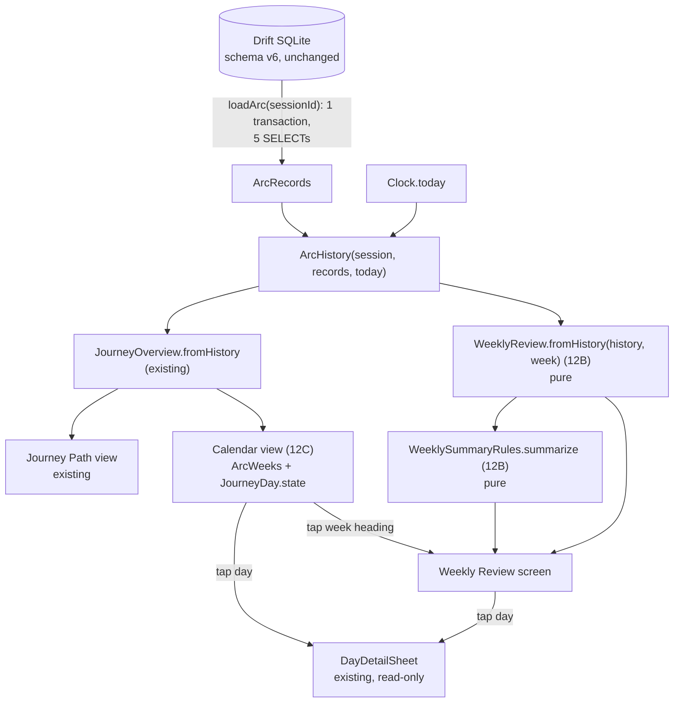

# Arc Momentum specification (NextRep v1.3.0)

Product and calculation specification for the two guaranteed v1.3.0
features, **Weekly Arc Review** and **Arc Consistency Calendar**. Written
in Phase 12A; nothing in it is implemented yet. Architecture evidence,
feasibility verdicts and the test plan are in
[PHASE_12A.md](PHASE_12A.md); phases and gates are in
[V1_3_ROADMAP.md](V1_3_ROADMAP.md).

Labels used throughout:

- **CONFIRMED**: verified in the source at `main` `28db2af`.
- **PROPOSED**: a design decision of this spec, to be built in 12B / 12C.
- **UNRESOLVED**: needs the owner's decision or later qualification.

Notation: `s` is a started `WinterArcSession`, `T` is today's local date
(`Clock.today()`), `h` is `ArcHistory(session: s, records:
loadArc(s.id), today: T)`, and `r(D)` is `h.recordOn(D)`, a `DayRecord`.
`~/` is Dart integer division (rounds down).

---

## 1. Product objective

v1.2.0 reminds users to stay on track. v1.3.0 helps them understand their
progress, using only what NextRep already stores on the device:

1. **How am I doing?** Weekly Review: this week's completion, full days,
   XP, Perfect Days and Minimum Days, plus one short supportive summary.
2. **Where am I struggling?** Weekly Review's "Room to grow" habit and the
   calendar's partial and missed days.
3. **What should I focus on next?** The same "Room to grow" habit, worded
   as a gentle suggestion, and the calendar's view of the whole Arc.

Both features are **read-only views of existing history**. They store
nothing, award nothing, change nothing and send nothing.

## 2. User stories

| # | As a user… | …I want to… | Feature |
|---|---|---|---|
| U1 | in the middle of an Arc | see how this week is going without doing arithmetic | Review |
| U2 | at the end of a week | see that week's final result, and that it won't change | Review |
| U3 | who had a hard week | read something kind and accurate, not a score that shames me | Review |
| U4 | with several habits | know which habit carried my week and which one needs care | Review |
| U5 | who joined a season late | have the days before I joined left out, not counted as failures | Review, Calendar |
| U6 | who used Minimum Days | see them as the deliberate choice they were, not as failures or Perfect Days | Review, Calendar |
| U7 | looking at the whole Arc | see all 92 days at a glance, by week | Calendar |
| U8 | curious about a past day | tap it and see exactly what happened that day | Calendar |
| U9 | after finishing an Arc | browse its weeks and calendar later, unchanged | Review, Calendar |
| U10 | using TalkBack or large text | get every number and state as text | Review, Calendar |

## 3. The NextRep week (PROPOSED, decision D1)

### 3.1 Decision

**A NextRep week is an Arc week: Arc days 1–7, 8–14, … 78–84, then a
final week of days 85–92.** There are always exactly **13 weeks**. Weeks 1
to 12 have 7 days; Week 13, the summit week, has 8.

Alternatives, evidence and trade-offs are in
[PHASE_12A.md § Decision D1](PHASE_12A.md#d1-week-model). In short:

- Day numbers are how the whole app talks about time (`Day 18 of 92`,
  Journey, chapters, milestones on Days 7 and 14). A calendar week would
  add a second clock to an app that has one.
- Calendar weeks give every Arc partial weeks at both ends (a Seasonal Arc
  starting on a Thursday: a 4-day first week, a 4-day last week, 14 weeks
  in all), and would depend on the locale's first day of the week. Nothing
  in the code has a week concept today (CONFIRMED: no `week` logic in
  `lib/`, only achievement titles).
- Arc weeks need nothing beyond `LocalDate` day arithmetic, which already
  copes with time zones and daylight saving time (`lib/core/time/local_date.dart`).
- Why 13 weeks and not a 1-day Week 14: a review of Day 92 alone would
  always be "too little data". Folding it into Week 13 keeps the last
  review meaningful. Its 8 days are labelled, never hidden.

### 3.2 Exact definitions

```
WEEKS            = 13
firstDay(w)      = 7·(w − 1) + 1                         for w in 1..13
lastDay(w)       = 7·w   for w in 1..12;   lastDay(13) = s.lengthInDays (= 92)
weekOf(d)        = min(13, (d − 1) ~/ 7 + 1)             for d in 1..92
dates(w)         = [ s.startDate.addDays(d − 1)  for d in firstDay(w)..lastDay(w) ]
```

`s.lengthInDays` is always 92 for a valid session (CONFIRMED:
`WinterArcRules.problemWith` in `lib/domain/winter_arc/winter_arc_session.dart`,
also enforced on restore by `lib/domain/backup/backup_validator.dart`).

Each date `D` in `dates(w)` falls into exactly one of these, checked in
this order:

| Day class | Rule | Counts in the review? |
|---|---|---|
| **neutral** | `s.isBeforeJoining(D)` (a season day before a late join) | Never |
| **upcoming** | `D.isAfter(T)` | Never |
| **open** (today) | `D == T` | Not in the totals; shown in its own "Today so far" block |
| **settled** | `s.isParticipatingOn(D)` and `D.isBefore(T)` | Yes |

The order matches `ArcHistory.journey()` (neutral before future) and
`ArcHistory.elapsedDates` (participating dates through `min(T, endDate)`).
A completed Arc has `T` after `endDate`, so all of its non-neutral days are
settled.

**Week status**, checked in this order:

| Status | Rule |
|---|---|
| `beforeJoining` | every date of the week is neutral |
| `complete` | `dates(w).last.isBefore(T)` |
| `inProgress` | `T` is in `dates(w)` and `s.isParticipatingOn(T)` |
| `upcoming` | otherwise (the first date is after `T`) |

- **Week start**: local midnight at the start of `dates(w).first`.
- **Week end**: the end of `dates(w).last`. A week becomes **final** at the
  first moment the device's local date is after `dates(w).last`. For
  Week 13 that is the same moment the Arc closes out
  (`ArcLifecycleService.reconcile`).
- **Future days** never count. **Pre-join (neutral) days** never count.
  "Neutral" is used only for those days; NextRep has no other neutral day.
- **Today's partial progress** is not in the week's totals. It's shown
  separately as "Today so far" and joins the totals at midnight. This way
  an unfinished day never looks like a miss, and the totals never jump
  around during the day (§ 4.3).
- **Current week**: `weekOf(s.dayNumberOf(T))` while
  `s.isParticipatingOn(T)`. When `s.isOverOn(T)`, there is no current week
  and the default review is Week 13. This depends only on the date, not on
  `status`, so it also covers an Arc that is over but not yet closed out
  (close-out runs at entry points, `ArcLifecycleService`).
- **Before the participation start**: if a time-zone or clock change puts
  `T` before `s.participationStart` (only possible for an Arc started or
  joined that day), the Arc has no settled or open day. **No week is
  reviewable**: the join week is `upcoming`, because `T` is either outside
  its dates or a neutral day in it, and every earlier week is
  `beforeJoining`. The Journey header hides the review button, and a
  review route shows an empty state: "Your first week review appears once
  your Arc has started." It never shows an error. Ledger XP dated on or
  after the participation start is future-dated for accounting (§ 4.5.1).
- **Join week**: `weekOf(s.joinDayNumber)`, which is Week 1 for every
  rolling Arc.
- **Reviewable weeks**: every week whose status is `complete` or
  `inProgress`, i.e. the range `joinWeek..currentWeek`, or
  `joinWeek..13` for a completed Arc. Users can open any of them, active
  or completed Arc alike. `upcoming` and `beforeJoining` weeks can't be
  opened.

### 3.3 Edge cases

| Situation | Result |
|---|---|
| Rolling Arc started on a Wednesday | Its weeks run Wednesday to Tuesday. No partial first week. |
| Seasonal Arc 2026 (1 Oct is a Thursday) | Weeks run Thursday to Wednesday; Week 13 is Thu 24 Dec – Thu 31 Dec (8 days). |
| Seasonal Arc joined on Day 18 | Weeks 1–2 are `beforeJoining`, shown on the calendar but not reviewable. Week 3 has 3 neutral days (15–17) and 4 participating days (18–21). |
| Today is the first day of a week, or the join day | The week is `inProgress` with no settled days: the START summary (§ 6) and the Today block only. |
| Arc completed (`s.isOverOn(T)`) | Every week from the join week to 13 is `complete`. Nothing changes again (history is read-only; CONFIRMED: writes only reach the active Arc, `CurrentArcService`). |
| Midnight passes with a review open | The screen re-reads (`dayChangedProvider` / `arcRefreshProvider`, bumped by `lib/app/app.dart` `_onDayChanged`). An `inProgress` week becomes `complete` or gets one more settled day. The screen stays on the week number it opened with. |
| Midnight after Day 92 with the review open | The Arc closes out. `/journey/...` needs an active Arc, so the router's existing redirect sends the user home (the completed Arc's summary). Nothing is lost. |
| Time zone change moves `T` back a day | Everything is recomputed from the new `T`. The new `T` becomes `open` again, just as Today allows. A day after it that already has progress or XP becomes `upcoming`: it's left out of the totals, and its ledger XP is counted only in the future-dated accounting term (§ 4.5.1). Nothing is stored, so nothing goes stale, and no XP is moved or lost. |
| Completed Arc and the date moves back to or before `endDate` | Week and day classes follow the dates, as Journey's do, so the last days show as open or upcoming until the date returns. The Arc stays completed and read-only. Nothing is reopened or written (§ 4.5.1). |
| Daylight saving time | No effect: `LocalDate` arithmetic runs on UTC midnights. |
| Goal edited mid-week | Each day keeps the target in effect that day (§ 4.2). |
| Habit disabled mid-week | Counted only on the days it was enabled. |
| A day with no enabled habits | The app can't create one: the last enabled habit can't be disabled (`HabitEditRules.apply`, `DomainRule.lastEnabledHabit`). If one ever came from outside, it adds 0 opportunities and still counts as a settled day that isn't full. No division by zero anywhere (§ 4). |

## 4. Weekly metrics (PROPOSED, decision D2)

### 4.1 Inputs, all CONFIRMED as existing and authoritative

| Input | Source | Meaning |
|---|---|---|
| Enabled habits of a date and their target | `HabitHistory.planFor(date, mode)` (`lib/domain/habit/habit_config.dart`) | The latest revision effective on or before the date, else the habit's baseline. Revisions are written only for the next challenge day, so a past date's result never changes. |
| Day mode | `ArcRecords.modeOn(date)`, `day_modes` table | `normal` unless a row says `minimum`. Past modes never change (`DayMode` doc). |
| Completion of a habit on a date | `DailyHabitProgress.completed` (stored) | For data the app writes: decided against that day's effective target (normal or minimum) by `HabitType.isCompletedBy`, and only re-evaluated while the day is today. A restored backup is checked against the value only for clock-time habits (`backup_validator.dart`); binary, count and duration flags are taken as stored. The review reads the flag as stored either way. |
| Perfect Day | `DayRecord.isPerfect` | Normal day and every enabled habit complete. |
| Completed Minimum Day | `DayRecord.isMinimumComplete` | Minimum Day and every enabled habit at its minimum. |
| XP of a date | `ArcRecords.xpByDate[date]` | Sum of the `xp_transactions` ledger rows dated that day (habit completions, Perfect Day bonus). |

### 4.2 Definitions

For a reviewable week `w`, let `S` be its **settled dates** (§ 3.2) in date
order and `N = |S|`. For each `D` in `S`, `H(D) = r(D).completion.total`
(enabled habits that day) and `C(D) = r(D).completion.completed`.

| Metric | Formula | Shown as | Notes |
|---|---|---|---|
| **Counted days** `N` | `|S|` | "5 days counted" | |
| **Habit opportunities** `H` | `Σ H(D)` over `S` | denominator of "24 of 35" | One opportunity = one habit enabled on one settled date. Minimum Days count too (at their minimum targets). |
| **Completed habit-days** `C` | `Σ C(D)` over `S` | "24 of 35" | Read from the stored `completed` flag, never recomputed. |
| **Habit completion %** | `H > 0 ? (100·C) ~/ H : none` | "68%" | Rounded down, as in `DayCompletion.percent`. |
| **Full days** `F` | count of `D` in `S` with `r(D).isPerfect ‖ r(D).isMinimumComplete` | "3 of 7 days full" | The numerator of the app's existing Consistency. |
| **Consistency %** | `N > 0 ? (100·F) ~/ N : none` | "Consistency 42%" | **The same formula as `ArcSummary.consistencyPercent` and `OverallInsight.consistencyPercent`**, limited to the week's settled days (decision D2). Those two include today for a running Arc. The review doesn't, so they match exactly for completed weeks and Arcs (§ 4.5). |
| **Perfect Days** `P` | count of `D` in `S` with `r(D).isPerfect` | "2" | No new bonus. |
| **Minimum Days chosen** `M` | count of `D` in `S` with `r(D).mode == DayMode.minimum` | "2 chosen" | A day returned to full targets is stored as `normal` and isn't counted. |
| **Minimum Days completed** `Mc` | count of `D` in `S` with `r(D).isMinimumComplete` | "Minimum Days completed 1" | The label Insights and Summary already use. |
| **XP earned** `X` | `Σ (h.records.xpByDate[D] ?? 0)` over `S` | "+420 XP" | Read from the ledger. Never derived from completions, never written. |
| Per habit: **applicable days** `a(i)` | count of `D` in `S` where `r(D).entryFor(id) != null` | "of 7 days" | Days on which the habit was enabled. |
| Per habit: **completed days** `c(i)` | count of `D` in `S` where that entry's `progress.completed` | "6 of 7 days" | |

**Today so far** (only for an `inProgress` week, `D = T`):
`r(T).completion.completed` of `r(T).completion.total`,
`xpByDate[T] ?? 0` XP so far, and the day's mode. This is shown, but it is
never part of `N, H, C, F, P, M, Mc` or `X`.

#### Why habit completion is the headline, and consistency is kept

- **CONFIRMED:** "Consistency" is already a user-visible metric with one
  meaning, full days ÷ days climbed: Insights
  (`lib/features/insights/insights_screen.dart`, with an explanatory
  footnote), Summary (`lib/features/summary/summary_screen.dart`) and the
  Arc History tile (`lib/features/history/widgets/arc_history_tile.dart`).
  Using the same word for habit completion would give one Arc two
  different "consistency" figures.
- So the review's large number is **Habit completion** ("24 of 35 · 68%").
  It moves with every habit, which makes it the kinder and more
  informative weekly signal. **Consistency** keeps its app-wide meaning:
  `F / N` for the week. It adds up across weeks (§ 4.5).
- The illustrative "Consistency 78% · Habits 32 / 41" from the phase brief
  is therefore shown as "Habit completion 78% · 32 of 41" plus a separate
  "Consistency" line. UNRESOLVED (owner, Gate A): approve this naming.

### 4.3 Rules this preserves

| Rule | How |
|---|---|
| Future days are never failures | Upcoming days aren't in `S`. |
| A day isn't missed just because it hasn't ended | Today is never in `S`. It has its own "so far" block. |
| Pre-join days are neutral | Excluded by `isBeforeJoining`, exactly like `ArcHistory`. |
| Minimum Day isn't failure | It's counted against its minimum targets. A completed one is a full day. The review's own text never says "missed" or "failed". A past Minimum Day with no progress shares Journey's `missed` day state, whose label § 7.2 / Q4 recommends renaming to "No progress". |
| Minimum Day never becomes a Perfect Day | `P` uses `isPerfect`, which requires `DayMode.normal`. |
| Historical goals are immutable | Completion is the stored flag, decided against that day's target. A later goal change never re-scores the past. |
| XP stays authoritative | `X` sums ledger rows. Opening a review writes nothing: no XP, no unlocks, no achievement sync. |
| No new achievements | The review never calls `AchievementService`. |

### 4.4 Highlights: Most consistent and Room to grow

Only computed when `N ≥ 3`, and only from habits with `a(i) ≥ 3`. Call
those habits `K`.

**Ordering.** Habit `i` ranks above `j` when `c(i)·a(j) > c(j)·a(i)`
(exact ratio, no rounding). Ties go to the larger `c(i)`, then to the
display order (`Habit.sortOrder`, the order `HabitHistory.habits` already
uses). This mirrors `InsightRules._byCompletion`, except that it falls back
to display order rather than id, because a review covers only one Arc.

- **Most consistent** (shown as "Most consistent this week"): the
  top-ranked habit in `K` with `2·c(i) ≥ a(i)` (at least half of its
  days). If there is none, nothing is shown.
- **Room to grow**: chosen from the habits in `K` with `2·c(i) < a(i)`,
  and only when **both** hold:
  - `C ≥ 1`, and
  - some habit `j` in `K` has a **strictly higher ratio**:
    `c(j)·a(i) > c(i)·a(j)`. Display order or day count don't count as
    "higher".

  The pick is the habit with the **lowest ratio**. If several share it,
  the one with **more applicable days** `a(i)` wins (more evidence), then
  the **earlier** display order. This is a separate ordering from the
  ranking above. If no habit qualifies, nothing is shown.

These rules give the following guarantees, each to be checked by a test:

- The two highlights are never the same habit (the 50% line separates them).
- With one habit, or with every habit in `K` at the same ratio, there is
  never a "Room to grow" (the strictly-higher-ratio condition).
- "Most consistent this week" is scoped to the week on purpose. Insights'
  "Most consistent" uses different rules (at least 7 days, across Arcs,
  ties by id; `insight_rules.dart`), so the weekly label always carries
  "this week".
- In a week with nothing completed, neither highlight appears, so no habit
  is singled out after a hard week.
- Small samples (`N < 3` or `a(i) < 3`) never produce a label.

### 4.5 Reconciliation (properties for 12B tests)

The weeks split an Arc's participating days. Below, `Σ_w` runs over all 13
weeks; weeks that can't be opened contribute 0. These identities must hold
**for every `T`**, including after the local date moves backwards (§ 3.3).

1. `Σ_w N(w) + [T open] = h.elapsedDates.length`. Here `[T open]` is 1 when
   `s.isParticipatingOn(T)`, else 0. Both sides come from the same `T`
   (`ArcHistory.elapsedDates` = participating dates through
   `min(T, endDate)`), so a rollback changes both equally.
2. Once `s.isOverOn(T)`, `(100·Σ F(w)) ~/ Σ N(w) = ArcSummary.consistencyPercent`.
   While `s.isParticipatingOn(T)`, `(100·(Σ F(w) + [today full])) ~/ (Σ N(w) + 1)`
   equals it. ArcSummary and Insights count today in their denominator,
   and the review doesn't (§ 4.2). Both cases follow from identity 1.
   When `T` is before the participation start, both sides have no days.
3. `Σ_w P(w) + [T open and Perfect] = h.perfectDays.total`. Both sides are
   derived from the same elapsed dates.
4. **The XP ledger split (corrected in review, finding F1).** See § 4.5.1:
   `Σ_w X(w) + todayXp + futureXp + otherXp = h.records.totalXp`, where
   `otherXp = 0` for every valid ledger.
5. For data written by the app (not a hand-made restore),
   `X = 15·C + 30·P` (`XpRules.habitCompletion`,
   `XpRules.perfectDayBonus`, DayRules invariants 2–3). The review never
   relies on this identity: restored backups only have to satisfy key
   formats and amounts 1..1000 (CONFIRMED: `backup_codec.dart`
   `x.integer('amount', min: 1, max: 1000)`), so the ledger wins.

#### 4.5.1 XP ledger split

**The earlier identity was wrong.** It read
`Σ_w X(w) + xpByDate[T] = h.records.totalXp`, with "`xpByDate[T]` is 0
for a completed Arc". That is false whenever the local date moves
backwards past a day that already has XP. For example: 15 XP is earned on
18 October, and a time-zone change then makes the local date 17 October.
The 18 October row stays in the ledger, the review rightly treats
18 October as upcoming, and the old identity would need `0 + 0 = 15`.
The app is right to keep that row. The identity was the mistake.

**What it rests on (CONFIRMED):**

- `h.records.totalXp` is by construction the sum of the per-date map.
  `DriftProgressRepository.loadArc` sets
  `totalXp: xpByDate.values.fold(0, …)` over
  `xp_transactions` grouped by `date`. So any split of the ledger's
  **dates** into disjoint groups sums exactly to `totalXp`: no row is
  missed and none counted twice.
- `T = Clock.today()` = `LocalDate.fromDateTime(DateTime.now())`, the
  device's current local date (`lib/core/time/clock.dart`). It can move
  backwards (time zone, clock change). Nothing persisted depends on it,
  and nothing ever rewrites a ledger row's date.
- **Ledger date invariant L:** every ledger row's date is a participating
  date of its Arc.
  - App writes: `commitDay` is reached only through
    `HabitTrackingService._trackableSession`, which requires
    `date == Clock.today()` and `session.isParticipatingOn(date)`.
  - The v1 → v2 migration's Perfect Day backfill is limited to
    `p.date BETWEEN s.start_date AND s.end_date`
    (`lib/core/database/app_database.dart`), and every pre-v5 Arc is a
    rolling Arc joined on its start date.
  - Restores: `BackupValidator`'s `checkDate` rejects any XP row whose
    date isn't `session.isParticipatingOn` (or is after the export date).

**The split.** For an Arc `s` on local date `T`, each ledger date `D`
falls into exactly one group. The groups are decided by `D` against `T`
first, then by participation:

| Group | Dates | Sum | Shown to the user as |
|---|---|---|---|
| **A. Settled XP** | `D < T` and `s.isParticipatingOn(D)` | `Σ_w X(w)` | the weekly "XP earned" totals |
| **B. Today's XP** `todayXp` | `D == T` and `s.isParticipatingOn(T)`; else 0 | `xpByDate[T] ?? 0` when `T` participates | the "Today so far" block, only while `T`'s week is `inProgress` |
| **C. Future-dated XP** `futureXp` | `D > T` | `Σ_{D > T} xpByDate[D]` | **nothing**: an accounting term, not a metric |
| **D. Other XP** `otherXp` | `D ≤ T` and not `s.isParticipatingOn(D)` | `Σ` over those dates | nothing. **Always 0** by invariant L |

Why the groups don't overlap and miss nothing: every `D` is `< T`,
`== T` or `> T`. The `≤ T` cases are then split by participation. Group A
equals `Σ_w X(w)` because every settled date belongs to exactly one week
(§ 3.2): a week holding a date `< T` is either `complete` or `inProgress`.
Hence:

```
Σ_w X(w) + todayXp + futureXp + otherXp = h.records.totalXp     (always)
otherXp = 0                                                     (invariant L)
⇒  Σ_w X(w) + todayXp + futureXp = h.records.totalXp            (every valid ledger)
```

`otherXp` is kept in the general form for one reason only. 12B tests
assert that it is 0 (invariant L) rather than assume it. The review never
displays or relies on it.

**How each case falls out:**

| Situation | Group B (today) | Group C (future) |
|---|---|---|
| Active Arc, the date never moved back | `xpByDate[T]` | 0 (every row is dated on the local day it was written, so none is after `T`) |
| Completed Arc, `s.isOverOn(T)` | 0 (`T` doesn't participate) | 0 |
| Date rollback inside the Arc | `xpByDate[T]` | the XP of the dates after the new `T` |
| Rollback across a week boundary | the new `T`'s XP | the later week's XP; the earlier week becomes `inProgress` again |
| Rollback before the participation start (any Arc started that day, rolling or seasonal) | 0 | the whole ledger; `Σ_w X(w) = 0` |
| Completed Arc and a rollback to `T ≤ endDate` | `xpByDate[T]` | XP dated after `T`. The closed Arc is never reopened or written; its last days show as open or upcoming until the date returns (the same date rule Journey already uses) |
| Late seasonal join | pre-join dates have no rows (invariant L), so their XP is 0 | as above |
| Day 92, then close-out | Day 92's XP is today's XP until midnight, then settled in Week 13 | 0 |
| Restored backup | as above. Restored rows meet invariant L, and the export date bound keeps them from being after the exporting device's date. On a device whose local date is behind that date, they're group C | as above |

**What this doesn't change:** XP shown to the user stays exactly as in
§ 4.2: settled participating dates only, today separately, future dates
never. Future-dated rows stay in the database untouched. They're never
moved, re-dated, deleted, re-derived from completions or re-awarded.
Nothing here changes XP keys, levels, streaks, achievements, Perfect Day
or Minimum Day logic. The app's existing total XP and level
(`ArcRecords.totalXp`, `LevelRules`) already include every ledger row,
future-dated or not, and v1.3 leaves that unchanged.

**Worked rollback example (explanatory, not a test result).** An active
Arc with one ledger row, `2026-10-18 → 15 XP` (a habit completed on
18 October).

| Local date `T` | Settled `Σ_w X(w)` | Today | Future-dated | Total | Check |
|---|---|---|---|---|---|
| 2026-10-17 (rolled back) | 0 | 0 (nothing dated 17 Oct) | 15 | 15 | `0 + 0 + 15 = 15` ✓ |
| 2026-10-18 (back to normal) | 0 | 15 ("Today so far") | 0 | 15 | `0 + 15 + 0 = 15` ✓ |
| 2026-10-19 (18 Oct settled) | 15 | 0 | 0 | 15 | `15 + 0 + 0 = 15` ✓ |

**Across a week boundary.** A rolling Arc started Wed 7 Oct 2026, so Week
1 = 7–13 Oct and Week 2 = 14–20 Oct. Its ledger: 13 Oct (Day 7) 105 XP,
14 Oct (Day 8) 60 XP; total 525 including 360 XP over Days 1–6. On
`T` = 14 Oct: `X(1) = 465`, today 60, future 0 → `465 + 60 + 0 = 525` ✓.
The local date then rolls back to 13 Oct. Week 1 is `inProgress` again
with `X(1) = 360`, today 105 and future 60 → `360 + 105 + 60 = 525` ✓.
Week 2 becomes `upcoming` and can't be opened, so its 60 XP is shown
nowhere until 14 Oct returns, and it isn't lost.

**Before the participation start.** A seasonal Arc joined on 18 Oct 2026
with 15 XP that day. The date then rolls back to 17 Oct. No week is
reviewable (§ 3.2, "Before the participation start"): Week 3 holds 17 Oct
only as a neutral day, so it's `upcoming`. Settled is 0, today is 0
(17 Oct isn't a participating date) and future is 15 →
`0 + 0 + 15 = 15` ✓. The same holds for a rolling Arc started that day.

### 4.6 Worked examples

Habits for examples 1–3, in display order: **Water** (count, target 8,
minimum 4), **Workout** (duration, 30 min, minimum 10), **Reading**
(binary), **Sleep Before** (clock time, 23:00), **No Junk Food** (binary).

**Example 1: a completed week, rolling Arc.** Started Wed 7 Oct 2026.
Week 1 = Days 1–7 = 7–13 Oct; today is 14 Oct.

| Day | Mode | Water | Workout | Reading | Sleep | No Junk | C/H | State | XP |
|---|---|---|---|---|---|---|---|---|---|
| 1 | normal | ✓ | ✓ | ✓ | ✓ | ✓ | 5/5 | Perfect | 105 |
| 2 | normal | ✓ | ✓ | – | ✓ | ✓ | 4/5 | Partial | 60 |
| 3 | minimum | ✓ | ✓ | ✓ | ✓ | ✓ | 5/5 | Minimum complete | 75 |
| 4 | normal | – | – | – | – | – | 0/5 | Missed | 0 |
| 5 | normal | ✓ | ✓ | – | – | ✓ | 3/5 | Partial | 45 |
| 6 | normal | ✓ | ✓ | ✓ | ✓ | ✓ | 5/5 | Perfect | 105 |
| 7 | minimum | ✓ | – | – | – | ✓ | 2/5 | Minimum partial | 30 |

- `N = 7`, `H = 35`, `C = 24` → habit completion `2400 ~/ 35 = 68%`.
- `F = 3` (days 1, 3, 6) → consistency `300 ~/ 7 = 42%`.
- `P = 2`, `M = 2`, `Mc = 1`.
- `X = 420` from the ledger. Check: `15·24 + 30·2 = 420`.
- Per habit: Water 6/7, Workout 5/7, Reading 3/7, Sleep 4/7, No Junk 6/7.
- Most consistent: Water and No Junk Food tie at 6/7 with 6 days each, so
  display order picks **Water**.
- Room to grow: Reading 3/7 is under half and below other habits, so
  **Reading**.
- Summary (§ 6): not all days full; 68% < 80; Day 4 (0 of 5) is followed
  by the full Day 6, so the rule is **RECOVERY**. "You found your way back
  this week. Every return matters. Water was a steady part of your week: 6
  of 7 days. Reading could use a little more attention next week."

**Example 2: the current week, with today open.** Seasonal Arc 2026,
today Sun 18 Oct (Day 18). Week 3 = Days 15–21 (Thu 15 – Wed 21 Oct).

- Settled: Days 15, 16, 17. Open: Day 18. Upcoming: 19–21 (not shown as
  misses).
- Day 15 Perfect (5/5), Day 16 4/5 (Reading not done), Day 17 Perfect.
- `N = 3`, `H = 15`, `C = 14` → `1400 ~/ 15 = 93%`. `F = 2` →
  consistency `200 ~/ 3 = 66%`. `P = 2`, `M = Mc = 0`.
  `X = 105 + 60 + 105 = 270`.
- Today so far: 2 of 5 habits, 30 XP. Neither is in the numbers above.
- Most consistent: four habits at 3/3, all with 3 days, so display order
  picks **Water**. Room to grow: Reading 2/3 is at least half, so **none**.
- Summary: **HIGH**, in-progress wording: "You've kept showing up so far
  this week. Keep that momentum going. Water has been steady so far: 3 of
  3 days."

**Example 3: late seasonal join.** Joined Sun 18 Oct 2026 (Day 18).

- Weeks 1 and 2 are `beforeJoining`. On the calendar they're neutral.
  They can't be opened as reviews.
- Week 3: Days 15–17 neutral; Day 18 is both the join day and today, so
  `N = 0`. Summary **START** (first-week wording): "Your Arc is just
  getting started. More days will reveal your rhythm."
- On 19 Oct: `N = 1` → **LOW_DATA**. On 21 Oct: `N = 3`, and highlights
  can appear.
- On 22 Oct Week 3 is `complete` with `N = 4`. Days 15–17 are never in
  any denominator.

**Example 4: goal revision and a disabled habit.** Rolling Arc, Week 2
(Days 8–14). On Day 9 the user raises Water from 8 to 10 (a revision
effective Day 10) and turns Workout off from Day 12.

- Day 9, Water 8/8 → completed (target 8 applied that day).
- Day 10, Water 9/10 → **not** completed, although 9 ≥ 8. The stored flag
  reflects Day 10's target. The review never re-scores it.
- Workout: `a = 4` (Days 8–11). Days 12–14 give it no opportunity, so `H`
  falls by 3. It isn't a "Room to grow" candidate unless `a ≥ 3` and it's
  under half.

**Example 5: Minimum Day returned to full.** On Day 30 the user switches
to Minimum, then taps "Return to full targets". The stored mode is
`normal` (`DayMode` doc), so the day counts as normal: Perfect if
everything is complete, never in `M`. A **past** Minimum Day stays Minimum
for good.

**Example 6: the summit week of a completed Arc.** Week 13 = Days 85–92,
8 settled days. Same formulas with `N = 8`. The wording leaves out "next
week" (§ 6.3).

**Example 7: a quiet week.** `N = 7`, `C = 0`, `X = 0`. Summary
**QUIET**. No highlights (Room to grow needs `C ≥ 1`).

## 5. Weekly Review UX (PROPOSED, decision D4)

### 5.1 Entry points and hierarchy

- **Entry: the Journey screen header**, for both the active Arc (Journey
  tab) and a completed Arc (`/arc/:id/journey`, reached from its summary's
  "View Journey"). The header gets one button: **"Week N review"** (the
  current week, or Week 13 for a completed Arc).
- **The calendar's week headings** (§ 7) link to that week's review.
- **Not on Today**: Today is the place for action, and it's already dense.
  **Not in Insights**: Insights covers all Arcs and is reached from History.
  **No new tab**: NextRep keeps its four tabs.
- **Routes** (PROPOSED). The UI always passes `week`:
  - Active Arc: `/journey/review?week=N`, a child of `/journey` on the
    **root navigator** (like `/today/habits`), so it covers the navigation
    bar. It isn't kept alive in a hidden tab.
  - Completed Arc: `/arc/:sessionId/review?week=N`.
  - CONFIRMED: `AppRoutes.redirect` already treats everything under
    `/journey` as needing an active Arc, and `/arc/:id/...` as history (it
    redirects to Today when `id` is the active Arc). Neither needs a new
    redirect rule.
  - Malformed `week` (missing, not an integer, out of `1..13`): show the
    current week (active) or Week 13 (completed). A week that can't be
    opened (`upcoming` / `beforeJoining`): show the nearest reviewable
    week. Never an error page.

### 5.2 Text wireframes

**In-progress week** (phone, 1× text):

```
┌──────────────────────────────────────────┐
│ ←  Week 3 review                          │
│ Seasonal Winter Arc · 1 Oct – 31 Dec 2026 │
│ Week 3 of 13 · Days 15–21                 │
│ Thu 15 Oct – Wed 21 Oct · In progress     │
│ [‹ Week 2]                                │
├──────────────────────────────────────────┤
│ You've kept showing up so far this week.  │
│ Keep that momentum going. Water has been  │
│ steady so far: 3 of 3 days.               │
├──────────────────────────────────────────┤
│  15    16    17    18    19    20    21   │
│  ★     ◐     ★     ◯     ·     ·     ·    │
│ Perf  Part  Perf  Today  Upcoming…        │
├──────────────────────────────────────────┤
│ HABIT COMPLETION            14 of 15 · 93% │
│ CONSISTENCY             66% · 2 of 3 full  │
│ XP EARNED                         +270 XP  │
│ PERFECT DAYS                            2  │
│ MINIMUM DAYS COMPLETED                  0  │
├──────────────────────────────────────────┤
│ TODAY SO FAR (Day 18)                      │
│ 2 of 5 habits · 30 XP                      │
│ Today counts once it ends.                 │
├──────────────────────────────────────────┤
│ MOST CONSISTENT THIS WEEK  💧 Water  3 of 3 │
├──────────────────────────────────────────┤
│ HABITS THIS WEEK                           │
│ Water 3 of 3 · Workout 3 of 3 ·            │
│ Reading 2 of 3 · Sleep Before 3 of 3 ·     │
│ No Junk Food 3 of 3                        │
│ (one row per habit)                        │
├──────────────────────────────────────────┤
│ Counts finished days; today is added when  │
│ it ends. Viewing a review never changes XP │
│ or progress.                               │
└──────────────────────────────────────────┘
```

**Completed week**: the same layout without the Today block. The status
reads "Complete", both navigation buttons appear where those weeks exist,
and a "Room to grow" row follows "Most consistent" when it applies:

```
│ MOST CONSISTENT THIS WEEK  💧 Water  6 of 7 │
│ ROOM TO GROW               📖 Reading 3 of 7 │
```

### 5.3 States

| # | State | Behaviour |
|---|---|---|
| 1 | Entry point | Journey header button "Week N review"; calendar week headings. |
| 2 | Screen hierarchy | Journey → Week review (root navigator) → day detail sheet (from the week strip). Week navigation replaces the location (`?week=`), so Back always returns to Journey. |
| 3 | Current week | `inProgress`: totals over settled days, Today so far block, in-progress wording, no "next" button. |
| 4 | Completed week | `complete`: final totals, past-tense wording, prev/next among reviewable weeks. |
| 5 | Empty | `N = 0` (the week starts today): the START summary, the week strip, the Today block and no stats grid. The empty stats grid is replaced by one line, "Stats appear after your first full day this week." |
| 6 | First week | Join week with `N ≤ 2`: first-week wording (START / LOW_DATA). No highlights. |
| 7 | Completed Arc | `/arc/:id/review`. Opens on Week 13, read-only, "Complete" on every week. The final-week wording drops "next week". |
| 8 | No active Arc | `/journey/review` redirects home (existing rule). Completed Arcs use `/arc/:id/review`. An Arc in setup has no Journey and no review. |
| 9 | Loading | `LoadingView`, as Journey. On refresh, keep showing the previous value (the Journey pattern `journey.hasError ? null : journey.value`). |
| 10 | Error | `FailureView(failure: toAppFailure(...), onRetry: invalidate)`, the pattern every screen uses. Storage errors are `PersistenceFailure`. |
| 11 | Offline | Fully offline: no network code at all (`test/app/network_boundary_test.dart` keeps guarding this). |
| 12 | Large text | One column; stats stack label over value at text scale > 1.3 (the `focus_guard_settings_screen.dart` rule); the week strip wraps to 4 per row (§ 7.4). |
| 13 | Screen reader | § 8. |
| 14 | Reduced motion | No animation is needed. If 12B adds any (none planned), it uses `context.motion`, which drops to zero. |
| 15 | Back | System back / AppBar back → Journey, wherever the user navigated between weeks. |
| 16 | Landscape, small screens | Content width capped at 600 dp and centred; `ListView` scrolls; nothing scrolls sideways. Checked in all six layouts of `test/integration/phase11e_layout_test.dart` (360×800 @ 2×, 320×568 @ 1.5×, 568×320, 800×360 @ 1.3×, 1280×800, 360×640 @ 1.3× with reduced motion), plus a 360×800 @ 1× layout that 12B adds. |

## 6. Weekly summary rules (PROPOSED, decision D3)

### 6.1 Requirements this meets

- Pure Dart, deterministic: the same `WeeklyReview` always gives the same
  output. No `Random`, no clock reads, no locale-dependent branches.
- No AI, no language model, no HTTP, nothing generated in the background,
  nothing uploaded, nothing persisted. The text is rebuilt each time the
  screen is drawn.
- Every sentence is backed by a rule that makes it true (no invented
  achievements). No judgemental words: never "failed", "missed", "lazy",
  "weak", "bad", "only".
- One headline per review and at most two habit lines, so it can't
  contradict itself (§ 6.4).
- Habit titles are the user's own text, shown as is, on the device only.

### 6.2 Output shape

`WeeklySummary { kind, tense (inProgress | complete), finalWeek,
firstWeek, mostConsistent?, roomToGrow? }`. The domain returns this
value; `lib/features/review/` turns it into text. Tests check both the
value and the exact strings.

### 6.3 Headline rules, the first match wins

| Priority | Kind | Condition | Complete-week text | In-progress text |
|---|---|---|---|---|
| 1 | START | `N == 0` | (not possible) | first week: "Your Arc is just getting started. More days will reveal your rhythm."  otherwise: "A new week begins today. One habit at a time." |
| 2 | LOW_DATA | `1 ≤ N ≤ 2` | "A short first week. More days will reveal your rhythm." | "Just a few days in. Your rhythm will show as the week goes on." |
| 3 | ALL_FULL | `F == N` | "Every day this week was a full day. That's real momentum." With `Mc ≥ 1`: "Every day this week was a full day, Minimum Days included. That's real momentum." | "Every day so far this week has been a full day." |
| 4 | HIGH | completion ≥ 80% | "You kept showing up this week. Keep that momentum going." | "You've kept showing up so far this week. Keep that momentum going." |
| 5 | RECOVERY | some `D1 < D2` in `S` with `2·C(D1) < H(D1)` and `D2` full | "You found your way back this week. Every return matters." | same |
| 6 | MINIMUM | `Mc ≥ 1` | "On harder days you chose a Minimum Day and still showed up." | same |
| 7 | STEADY | completion ≥ 50% | "You completed at least half of your habits this week. Small steps add up." | "…so far this week. Small steps add up." |
| 8 | SOME | `C ≥ 1` | "This week had its challenges, and you still made progress. Next week is a fresh start." | "This week has had its challenges, and you're still making progress." |
| 9 | QUIET | `C == 0` | "This week was quiet. Whenever you're ready, one habit is a good place to start." | "A quiet start to the week. One habit is a good place to begin." |

**Comparisons.** "completion ≥ 80%" and "≥ 50%" compare the **floored
integer** `(100·C) ~/ H` (so 79.9% is 79, not HIGH). When `H = 0`,
completion is *none*, and HIGH and STEADY don't match. Such a week then
falls through to SOME or QUIET by `C`.

**Final week (Week 13).** When the week is `complete`, these variants
replace the text above, because the Arc has no next week:

| Kind | Final-week complete text |
|---|---|
| LOW_DATA | "A short final week. Every day you showed up counts." |
| HIGH | "You kept showing up all the way to the summit." |
| SOME | "This week had its challenges, and you still made progress." |
| QUIET | "The final week was quiet. Reaching the end of an Arc still matters." |

START, ALL_FULL, RECOVERY, MINIMUM and STEADY don't look ahead, so they
keep their text. An **in-progress** Week 13 (an active Arc on Days 85–92)
uses the in-progress text: the Arc continues until Day 92, so
looking ahead to the rest of the week is still true.

LOW_DATA's complete-week text only happens for a late join's short join
week. For other weeks `N` is at least 7 once complete.

### 6.4 Habit lines, after the headline

| Line | Condition | Complete | In progress | Final week |
|---|---|---|---|---|
| 1 | Most consistent exists (§ 4.4) | "{Habit} was a steady part of your week: {c} of {a} days." | "{Habit} has been steady so far: {c} of {a} days." | as complete |
| 2 | Room to grow exists (§ 4.4) | "{Habit} could use a little more attention next week." | "{Habit} could use a little attention in the days ahead." | "{Habit} had the most room to grow this week." |

The "Final week" column applies only to a `complete` Week 13. An
in-progress Week 13 uses the in-progress column.

**No contradictions**, each to be tested exhaustively over small
generated weeks:

- ALL_FULL means every habit was completed on every settled day, so there
  is no Room to grow.
- QUIET means `C = 0`, so there are no highlights.
- START and LOW_DATA mean `N < 3`, so there are no highlights.
- HIGH can appear with a Room-to-grow line, because they talk about
  different things (the week as a whole, one habit). "Water steady" never
  appears next to Water as Room to grow (the 50% split, § 4.4).

## 7. Arc Consistency Calendar (PROPOSED, decisions D5–D6)

### 7.1 Placement

- **A second view inside Journey**: the header gets a two-segment control,
  **Path | Calendar** (`SegmentedButton`, which is standard Material 3).
  Path stays the default. The choice lasts as long as the screen is open
  and isn't persisted. It's available in the Journey tab and in a
  completed Arc's Journey (`/arc/:id/journey`).
- Why there: Journey already loads the whole Arc as `JourneyOverview.days`
  (92 `JourneyDay`s, CONFIRMED in `lib/domain/journey/journey_overview.dart`).
  The calendar is another layout of the same data: **no new query, no new
  route, no new tab**.

### 7.2 Day states and precedence (definitive)

**The calendar uses `JourneyDayState`** (`lib/domain/journey/journey_day.dart`)
**unchanged.** It's already a single, non-overlapping classification
computed by `ArcHistory.journey()` and `JourneyRules.stateOf`. A second
classifier would be the competing engine the brief forbids.

How the brief's proposed concepts map onto it:

| Proposed concept | Domain state | Notes |
|---|---|---|
| Future day | `future` | After today. |
| Neutral / pre-join day | `notJoined` | Seasonal, before a late join. |
| No recorded progress | `missed` (past) / `today` (current) | A past day where no enabled habit has `currentValue > 0`, in either mode. |
| Partial progress | `partial` (normal) / `minimumPartial` (Minimum) / `today` | |
| All full targets achieved | `perfect` | **Not a separate state.** On a normal day, "all full targets" is exactly `isPerfect`. On a Minimum Day, completion is stored against the minimum targets, so "all full targets" isn't a stored fact. Deriving it would re-score history, so it's never shown. |
| Minimum Day | `minimumComplete` / `minimumPartial` (a Minimum Day without progress is `missed`, and its detail sheet still says "Minimum Day") | |
| Perfect Day | `perfect` | |

**Precedence.** The first row that matches decides. This is the order of
`ArcHistory._journeyDay` and `JourneyRules.stateOf` (CONFIRMED):

| Order | State | Condition | Label (existing `JourneyDayStyle.label`) | Shape | Fill | Icon | Extra cue |
|---|---|---|---|---|---|---|---|
| 1 | `notJoined` | `s.isBeforeJoining(D)` | Before you joined | circle | none | – | dashed outline, opacity 0.45 |
| 2 | `future` | `D.isAfter(T)` | Upcoming | circle | none | – | opacity 0.55 |
| 3 | `perfect` | `r(D).isPerfect` | Perfect | circle | full | star | static glow (`BoxShadow`) |
| 4 | `minimumComplete` | `r(D).isMinimumComplete` | Minimum complete | rounded square | full | flame | static glow |
| 5 | `today` | `D == T` | Today | circle | none | – | static glow; "Today" in the label |
| 6 | `missed` | `!r(D).hasProgress` | Missed | circle | none | dash | opacity 0.7 |
| 7 | `minimumPartial` | Minimum mode | Minimum partial | rounded square | half | – | |
| 8 | `partial` | otherwise | Partial | circle | half | – | |

CONFIRMED from `journey_day_style.dart` and `journey_marker.dart`: the
glow is an unconditional `BoxShadow` on `perfect`, `minimumComplete` and
`today` (not motion, so reduced motion doesn't change it). Whichever cell
is today, in any of states 3–5, also gets a **3 dp `snow` border** and the
glow. In Journey the opacity applies to the whole marker, day number
included. The calendar changes that (PROPOSED): only the glyph's fill is
dimmed. The day number and the outline stay at full contrast (§ 8.3).

Consequences, each covered by a 12C test:

- A Minimum Day can never look like a Perfect Day: they differ in shape
  (square vs circle), icon (flame vs star) and label.
- Today never looks final: today can only be `perfect`,
  `minimumComplete` or `today` (orders 3–5), never `missed` or `partial`.
- Every day has exactly one state. The calendar and Journey always agree,
  because they're one computation.
- UNRESOLVED (owner, copy only, Q4): the existing label "Missed" applies
  to Journey, the calendar and the review's week strip alike. That
  includes a past **Minimum Day with no progress**, which Journey already
  labels "Missed" today. This conflicts with the brief's "do not confuse a
  Minimum Day with failure". **Recommendation:** in 12C, change the
  `missed` label to "No progress" (`JourneyDayStyle.label` and
  `journeyDayLabel`, one place, both views). For a Minimum Day, the
  detail sheet keeps saying "Minimum Day". The state and its precedence
  don't change. This is copy, not a domain change.

### 7.3 Layout

- **Structure: 13 Arc-week blocks**, Week 1 first, top to bottom, matching
  the Weekly Review (§ 3). Each block is a heading plus its days in Arc
  order, left to right. Week 13's eighth day (Day 92, the summit) wraps
  onto its own line inside the Week 13 block.
- **Why not months**: a Rolling Arc spans four calendar months with blank
  leading cells, and the first weekday depends on the locale. Arc weeks
  give every Arc the same 13-block shape, and each block lines up with
  that week's review.
- **Week heading** (text, also the review link):
  `Week 3 · 15–21 Oct · 2 of 7 days full ›`, with dates from
  `DateFormat('d MMM')` (already used by `journey_path.dart`). A range that
  crosses a month reads "29 Oct – 4 Nov"; one that crosses a year adds the
  year ("28 Dec 2026 – 3 Jan 2027", rolling Arcs only). The "x of y days
  full" part counts settled participating days only, like § 4. It's left
  out for `upcoming` and `beforeJoining` weeks, which read
  "Upcoming" or "Before you joined" and have no link.
- **Chapter boundaries**: chapters (1–14, 15–30, 31–45, 46–60, 61–75,
  76–92; `JourneyChapter`) don't line up with weeks. A week where a chapter
  starts adds a second heading line, e.g. "First Ascent begins on Day 15",
  using `chapterTitle` from `lib/shared/formatting/arc_labels.dart`. Text,
  not a colour band.
- **Cell**: the Arc day number (top) and the state glyph drawn from
  `JourneyDayStyle` (shape, fill, icon, dashed outline). Cells are all the
  same size, unlike Journey markers, which change size by state. The
  `opacity` value dims only the glyph's fill. **The day number and the
  glyph outline are never dimmed** (a calendar change from Journey, § 7.2
  and § 8.3).
- **Seasonal Arcs**: day numbers are season days (Day 1 = 1 Oct); weeks
  run Thursday to Wednesday in 2026. A late join shows its neutral weeks
  and days greyed and dashed, with the Journey note above the grid:
  "Joined on Day 18. Earlier days don't count against you." (existing
  copy).
- **Rolling Arcs**: day numbers from the start date. Week headings carry
  the real dates.
- **Completed Arcs**: there is no `today` state, every non-neutral day is
  final, and the headings show "x of y days full" for every week.
- **Today**: the same 3 dp `snow` border and glow as Journey's today
  marker, and its week heading gets "· This week". When the calendar opens, it scrolls so the current week is
  visible (Week 13 for a completed Arc).
- **Tapping a day**: exactly as Journey does (CONFIRMED in
  `DayDetailSheet.show`). `notJoined` opens `NotJoinedDaySheet`; past days
  and today open the read-only `DayDetailSheet`; `future` does nothing and
  isn't announced as a button. Nothing in the calendar can change progress.

### 7.4 Sizing

| Condition | Days per line | Cell |
|---|---|---|
| Text scale ≤ 1.3 and `(width − 2·8) / 7 ≥ 48` dp (width ≥ 352 dp) | 7 | `(width − 16) / 7` wide, min 48 dp tall; tap targets touch, the visible glyph sits inset |
| Text scale > 1.3, or width < 352 dp | 4 (a week takes 2 lines) | `(width − 16) / 4` wide; min 48 dp tall |
| Landscape / tablet | 7, content capped at 600 dp wide and centred | |

The grid uses an 8 dp side gutter (`WinterSpacing.sm`); headings keep the
usual 16 dp. On a 360 dp phone at 1×, a cell is `(360 − 16) / 7 ≈ 49` dp,
which meets the 48×48 dp target (A9). On a 320 dp phone, or above 1.3×
text, the 4-per-line layout is used. Nothing scrolls sideways.

## 8. Accessibility requirements

### 8.1 Screen reader semantics

| Element | Announcement (example) | Role |
|---|---|---|
| Calendar cell | "Day 18, Sunday 18 October. Today. 40 percent complete." The existing `journeyDayLabel` with the date added after the day number (PROPOSED `calendarDayLabel`). | button, except `future` |
| Calendar neutral cell | "Day 8, Thursday 8 October. Before you joined this Seasonal Winter Arc." | button (opens the note, as in Journey) |
| Week heading | "Week 3 of 13, 15 to 21 October, 2 of 7 days full. Opens the week review." | header + button |
| Review header | "Week 3 of 13. Days 15 to 21. Thursday 15 October to Wednesday 21 October. In progress." | header |
| Stat | "Habit completion: 14 of 15, 93 percent." | one merged node per stat (`excludeSemantics` with a full label, the pattern of the Journey chapter card) |
| Today block | "Today so far, Day 18: 2 of 5 habits, 30 XP. Today counts once it ends." | merged |
| Highlight | "Most consistent this week: Water, 3 of 3 days." / "Room to grow: Reading, 3 of 7 days." | merged |
| Summary | its full text, as one paragraph | text |

- Every number on screen is also in a semantics label. There are **no
  charts** in the review. The week strip is a row of labelled markers.
- **Focus order**: review header → summary → week strip (Arc order) →
  stats → Today → highlights → per-habit list. Calendar: view switch →
  for each week, its heading and then its days left to right. Each week is
  a `FocusTraversalGroup` with the reading-order policy.
- **Keyboard / switch access**: every interactive cell and heading takes
  focus, shows Material's focus highlight, and activates with
  Enter / Space.

### 8.2 Text scaling

At 2× on a 360 dp phone, nothing is clipped or overflows. The review
stacks into one column; the calendar uses 4 days per line; headings wrap.

### 8.3 Colour and contrast

Measured from `WinterColors.night` (`lib/app/theme/winter_tokens.dart`)
against `surface` `#111A2E`. That is the worst case: `background` and the
dimmed Journey scene are darker, so ratios there are higher.
`textPrimary` 16.0:1, `textSecondary` 6.2:1, `accentSecondary` 11.0:1,
`recovery` 8.6:1, `outline` only 1.4:1.

- Day numbers and all text use `textPrimary` or `textSecondary` (at least
  4.5:1) and are never dimmed.
- State never depends on colour alone: shape, fill, icon, dashed outline
  and the label are redundant cues (the design `JourneyDayStyle` already
  documents).
- **Non-text contrast (WCAG 1.4.11, 3:1).** In Journey the `future` and
  `notJoined` glyphs use the `outline` colour (1.4:1), dimmed further, so
  they fall short. PROPOSED for the calendar: draw their outline (dashed
  for `notJoined`) in `textSecondary` at full opacity (6.2:1). Each state's
  outline colour must reach ≥ 3:1 against `surface`, which a unit test
  checks from the tokens (A12). Journey itself is unchanged in v1.3.
- The calendar reuses Journey's **Legend** sheet: shapes and words, and
  the existing info button in the Journey header. `_Legend` is private to
  `lib/features/journey/journey_screen.dart` today, and both views are in
  that screen, so no new widget is needed.
- High contrast: where the platform reports it (`MediaQuery.highContrastOf`,
  iOS), dimmed glyphs are drawn at full opacity. Android exposes no
  equivalent to Flutter. Its high-contrast text is handled by the OS
  renderer.

### 8.4 Reduced motion

Neither feature needs motion. Nothing animates for decoration. If the
calendar scrolls to the current week on open, the jump is instant (an
initial scroll offset, as `JourneyPath` already does). The ambient winter
scene behind Journey already follows `WinterMotion.ambient`.

### 8.5 Acceptance criteria

| # | Criterion | Checked by |
|---|---|---|
| A1 | 1× text, 360×800: every element visible, no overflow | widget + a 1× layout added to the sweep in 12B |
| A2 | 2× text, 360×800: no overflow; review in one column; calendar 4 per line | layout sweep; emulator at 2× / 360 dp (12E) |
| A3 | 1.5× text, 320×568: no overflow, no sideways scroll | layout sweep |
| A4 | Landscape 568×320 and 800×360 @ 1.3×: reachable by scrolling, width ≤ 600 dp | layout sweep |
| A5 | Reduced motion: no animation runs (`tester.binding.hasScheduledFrame` false after the first frames), and the winter scene stops | widget test |
| A6 | Each of the 8 states has a distinct (shape, fill, icon, dashed) tuple, or a distinct label where the glyph is shared | unit test over `JourneyDayStyle` |
| A7 | Every calendar cell and review stat has a non-empty semantics label with its number and state in words | widget test (semantics tree) |
| A8 | TalkBack on the emulator: the review and calendar read in the § 8.1 order | emulator, manual (12E) |
| A9 | Touch targets ≥ 48×48 dp (`androidTapTargetGuideline`) and labelled tappables (`labeledTapTargetGuideline`) | widget test (`meetsGuideline`) |
| A10 | Text contrast ≥ 4.5:1 (`textContrastGuideline`) | widget test |
| A11 | iOS: compiles and runs on the simulator (`flutter build ios --simulator`, an iOS smoke) | 12E / 12F |
| A12 | Calendar glyph outlines of every state ≥ 3:1 against `surface` (non-text contrast) | unit test over the tokens |

## 9. Data flow



Nothing flows back to the database. The only arrows into storage are the
existing write paths (`ProgressRepository.commitDay`), which these features
never call.

## 10. Performance expectations

| | Weekly Review | Calendar |
|---|---|---|
| Queries per open | the session lookup (`CurrentArcService`: 2 queries for the active Arc, 1 by id) plus one `loadArc`, which is 5 SELECTs in one transaction (progress, modes, XP grouped by date, habits, revisions). Fewer than Journey, whose provider also runs the close-out check and an achievement sync with a second `loadArc`. The review never runs either | **0 extra**: it uses the `JourneyOverview` the Journey screen has already loaded |
| Per-day queries | none (no N+1) | none |
| CPU | ≤ 8 day records (cached in `ArcHistory._cache`) × ≤ 12 habits | 92 `JourneyDay`s, already computed for Journey |
| Worst-case habit lookups | `configOn` scans one habit's revisions: ≤ 92 per habit (one per date, by primary key), so at most about 8 × 12 × 92 ≈ 9k comparisons | at most 92 × 12 × 92 ≈ 100k comparisons, already paid by Journey today |
| Rebuilds | autoDispose provider, re-read on `arcRefreshProvider` / `dayChangedProvider` / resume. It's on the root navigator, so it isn't alive while Today is used | rebuilds with Journey; cells built in a lazy `ListView` by week block |
| Persistence or cache | none | none |

There's no evidence of a problem, so nothing is cached or persisted
(decision D7). The 12E qualification measures a profile build on the
emulator and records the numbers without gating on them. A regression shows
up as an extra `loadArc` call, which the tests count.

## 11. Acceptance criteria (features)

**Weekly Review (12B)**

- R1 Weeks follow § 3.2 exactly, for rolling, seasonal and late-joined
  Arcs, including the 8-day Week 13.
- R2 Metrics follow § 4.2. Future, neutral and open days are never in the
  totals.
- R3 The § 4.5 reconciliation identities hold for generated Arcs and for
  every local date, including after the date moves backwards (the XP
  ledger split of § 4.5.1).
- R4 Summaries follow § 6 exactly, are identical across repeated runs, and
  never contradict each other.
- R5 Opening any review writes nothing: the database (every table) is
  byte-identical before and after. The review provider must not reuse
  `journeyControllerProvider`, which closes out Arcs and syncs
  achievements, both of which can write.
- R6 No network: guarded by `test/app/network_boundary_test.dart`.
- R7 Every state in § 5.3 is reachable and tested.
- R8 Accessibility A1–A11.

**Calendar (12C)**

- K1 It shows all 92 days in 13 week blocks, with the same states as
  Journey for the same `today`.
- K2 State precedence follows § 7.2, every state is distinguishable without
  colour, and Minimum Days never look Perfect.
- K3 Taps open the existing read-only sheets. Future days do nothing.
- K4 It makes no additional repository calls beyond Journey's, and writes
  nothing: switching Path → Calendar on a loaded Journey leaves every table
  byte-identical. The calendar itself writes nothing. Journey's own
  entry-point writes (close-out, achievement sync) are existing behaviour,
  and they're not part of this check.
- K5 Completed Arcs render read-only and unchanged over time (the same
  output for any later `today`).
- K6 Accessibility A1–A11.
